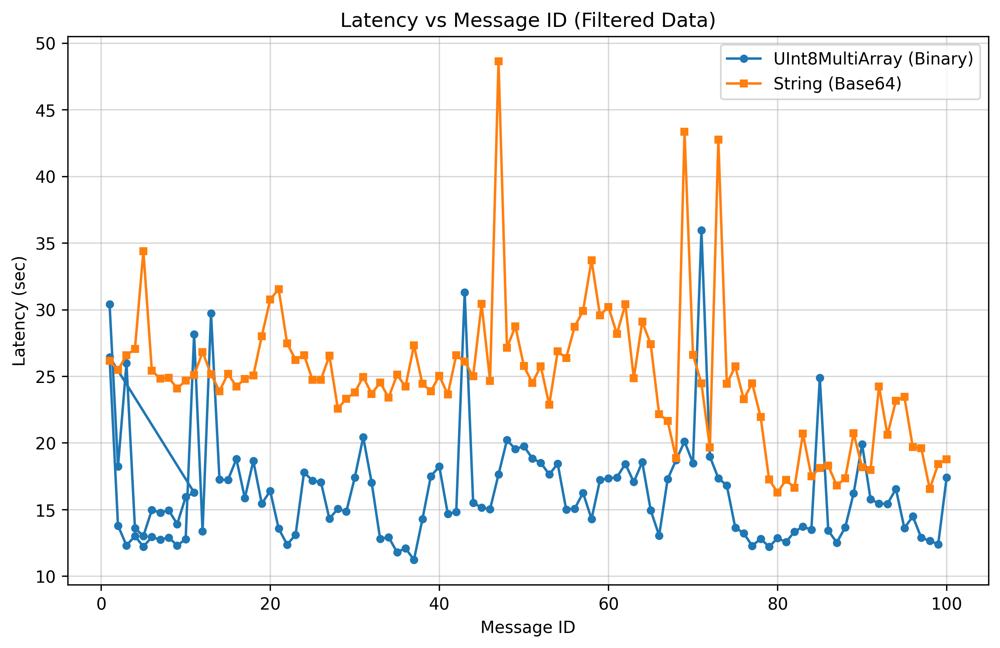
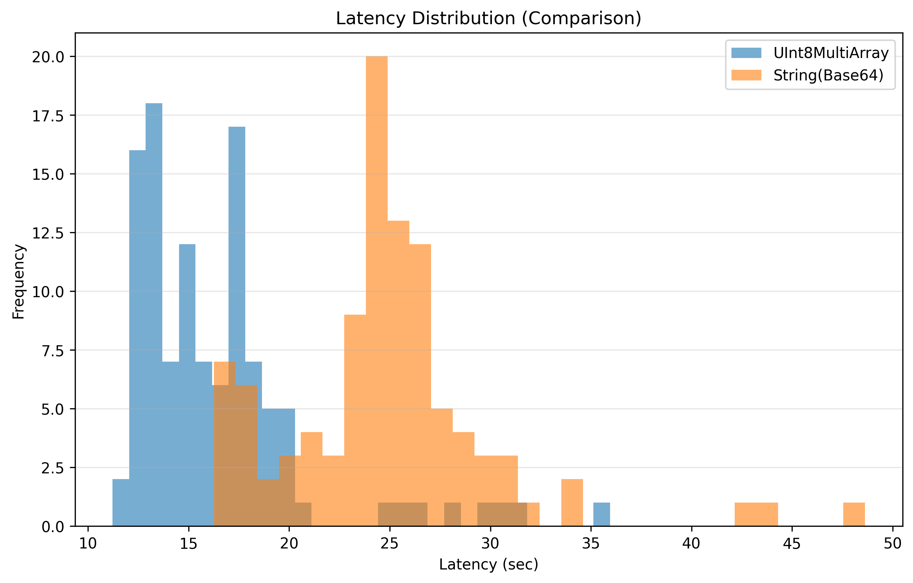
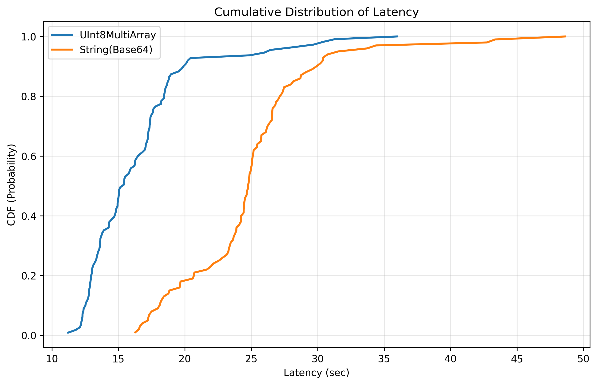
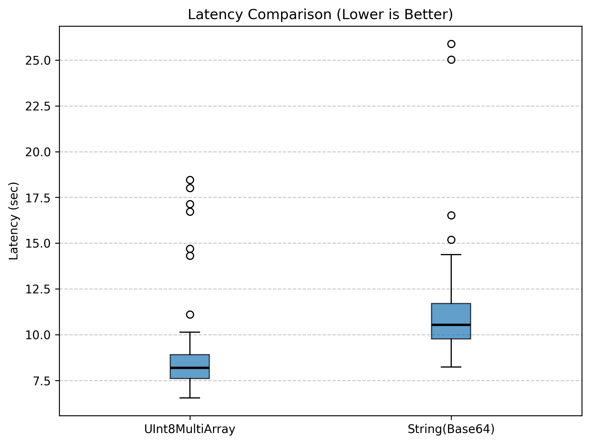
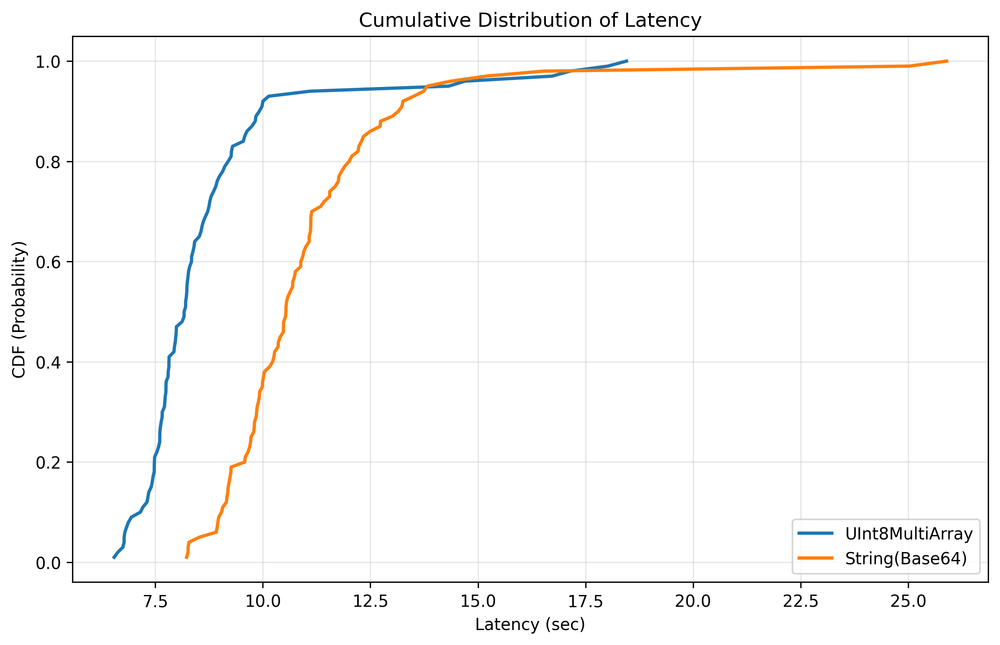

# ROS 2 Latency Benchmark: UInt8MultiArray vs. String Base64

This project benchmarks the performance of two data transmission methods in Ros2 Jazzy version when handling large payloads (**150 MB**). The data represents a `float32` NumPy array. 

**First Experiment Setup:**
* **Payload:** 150 MB (randomly generated `float32` array).
* **Environment:** Publisher and Subscriber running on the same X86 machine.

**Second Experiment Setup:**
* **Payload:** 150 MB (randomly generated `float32` array).
* **Environment:** Publisher runs on X86 machine and Subscriber runs on a Jetson Nano.
* **Network Type:** Local Network 

**Third Experiment Setup:**
* **Payload:** 150 MB (randomly generated `float32` array).
* **Environment:** Publisher runs on X86 machine and Subscriber runs on another X86 machine.
* **Network Type:** Local Network

## First Experiment
We compared **UInt8MultiArray** (Raw Binary) against **String Base64** (Text Encoding). The goal was to measure **Latency**—the total time from message publication to successful receipt and reconstruction.

### The Results at a Glance
| Metric | UInt8MultiArray (Binary) | String (Base64) |
| :--- | :--- | :--- |
| **Payload Size** | 150 MB | 150 MB |
| **Transmission Size** | ~150 MB | ~200 MB (33% overhead) |
| **Average Latency** | **0.8447 seconds** | **1.3001 seconds** |
| **Performance Gain** | **~35% Faster** | - |

---

## Key Findings

### 1. Speed & Efficiency: The "Serialization Tax"
The **UInt8MultiArray** is significantly faster because it uses raw memory casting. By calling `.tobytes()` and `np.frombuffer()`, the system avoids complex data translation. 

The **String (Base64)** method incurs a heavy "Serialization Tax." The CPU must mathematically transform every byte into an ASCII character, increasing the data volume to **200 MB** and adding a constant overhead of roughly **0.45 seconds**.

*Note: Both methods show a "warm-up" spike for the first few messages before stabilizing.*

### 2. Stability & Jitter
As shown in the distribution plots, the binary method is not only faster but more **predictable**:
- **Binary (Blue):** Highly stable with very low variance (tightly packed histogram).
- **Base64 (Orange):** Exhibits significant **jitter** (latency spikes). This is due to the inconsistent CPU time required to decode large Base64 strings.

---

### Visualization Summary

* **Box Plot:** Demonstrates that the "worst-case" outliers for the binary method are still significantly faster than the "best-case" scenarios for Base64.
* **Histogram:** Displays two distinct, non-overlapping populations. The binary group is localized at the 0.8s mark, while the Base64 group is spread across the 1.3s mark.
* **CDF Plot:** Confirms that **100%** of binary messages are fully processed before the first Base64 message even arrives.

## Second Experiment
We compared **UInt8MultiArray** (Raw Binary) against **String Base64** (Text Encoding). The goal was to measure **Latency**—the total time from message publication to successful receipt and reconstruction.

### The Results at a Glance
| Metric | UInt8MultiArray (Binary) | String (Base64)        |
| :--- |:-------------------------|:-----------------------|
| **Payload Size** | 150 MB                   | 150 MB                 |
| **Transmission Size** | ~150 MB                  | ~200 MB (33% overhead) |
| **Average Latency** | **16.3764 seconds**      | **24.8816 seconds**    |
| **Performance Gain** | **~34.2% Faster**        | -                      |

---

## Key Findings

### 1. Speed & Efficiency: The "Serialization Tax"
In a multi-machine environment, UInt8MultiArray is the superior transport method because it minimizes the raw data footprint. By utilizing .tobytes() and np.frombuffer(), the system performs a direct memory cast to raw binary, ensuring that only the original 150 MB is pushed to the network interface.

In contrast, the String (Base64) method imposes a massive "Bandwidth Tax." Beyond the CPU overhead of mathematical transformation, the encoding expands the data volume by 33%, forcing the network to handle 200 MB per message. This expansion directly causes the ~8.5-second latency gap observed in the results.

Note: Both methods exhibit an initial "warm-up" spike (visible in the Msg ID plot) as the DDS middleware establishes discovery and allocates network buffers before reaching a stabilized, albeit volatile, state.

*Note: Both methods show a "warm-up" spike for the first few messages before stabilizing.*

### 2. Stability & Jitter
The Multi-Machine experiment confirms that the binary method is not only faster but far more predictable under heavy network load.

* UInt8MultiArray (Blue): Demonstrates high consistency. In the histogram, the blue bars form a tight, tall "tower" between 12 and 18 seconds. This indicates that the network can reliably handle the 150 MB binary payload with minimal variance.

* Base64 (Orange): Exhibits extreme jitter and unpredictability. The orange distribution is much wider and shifted significantly to the right (peaking around 25 seconds). Because the 200 MB payload pushes the network to its physical limit, even minor congestion causes massive delays, as seen in the "long tail" of the histogram and the boxplot outliers reaching 48+ seconds.

* The Overlap Zone: The small brownish region where the two shapes meet (roughly between 16 and 20 seconds) represents rare instances where the methods perform similarly. This occurs when a "lucky" String message catches a window of perfect network health, allowing it to match the speed of a "slow" Binary message delayed by a minor collision. However, this is the exception, not the rule; the vast separation of the peaks proves that Binary is systematically superior.

### Visualization Summary

* **Box Plot:** Highlights the massive performance gap; the "worst-case" outliers for the Binary method (the highest spikes) are still significantly faster than the "average" (median) performance of the Base64 method.

* **Histogram:** Displays two distinct populations with a minimal overlap zone. The Binary group is localized and tall between 12s and 18s, while the Base64 group is spread much wider across the 24s to 28s range, demonstrating higher variance.

* **CDF Plot:** Confirms a "Deterministic vs. Probabilistic" divide. The steep Binary curve shows that 90% of binary messages are fully processed before even the first 20% of Base64 messages arrive, proving far superior reliability for time-critical tasks.

## Third Experiment
We compared **UInt8MultiArray** (Raw Binary) against **String Base64** (Text Encoding) across two high-performance **x86 machines**. The goal was to measure **Latency**—the total time from message publication to successful receipt and reconstruction.

### The Results at a Glance
| Metric | UInt8MultiArray (Binary) | String (Base64) |
| :--- | :--- | :--- |
| **Payload Size** | 150 MB | 150 MB |
| **Transmission Size** | ~150 MB | ~200 MB (33% overhead) |
| **Average Latency** | **8.6934 seconds** | **11.0463 seconds** |
| **Performance Gain** | **~21.3% Faster** | - |

---

## Key Findings

### 1. Speed & Efficiency: Processing Power vs. Bandwidth
In this x86-to-x86 environment, the powerful processors significantly reduce the absolute latency compared to the Jetson Nano (Experiment 2). However, the **Binary** method still holds a clear lead. By utilizing direct memory casting, the system avoids the overhead of text conversion, ensuring the network only has to move the original 150 MB.

Despite the high-end CPUs, the **String (Base64)** method remains slower due to the inescapable "Bandwidth Tax." Pushing 200 MB over the local network remains the primary bottleneck, adding over **2 seconds** of latency compared to the raw binary approach.

*Note: The time-series plot shows that while x86 handles data faster, the String method still suffers from higher volatility and periodic spikes.*

### 2. Stability & Jitter
Even with superior hardware, the binary method proves to be the most reliable for high-bandwidth communication:

* **UInt8MultiArray (Blue):** Highly consistent. The histogram shows a tight cluster peaking between **7s and 9s**. This narrow distribution indicates a highly stable and predictable communication channel.
* **Base64 (Orange):** Shows increased variance and a clear shift to the right. The distribution is wider, peaking between **10s and 12s**, and remains susceptible to network-induced jitter.
* **The Overlap Zone:** While there is a moderate overlap between 8s and 10s where x86 processing power helps "mask" the Base64 overhead, the Binary method's peak is consistently lower, proving it is the only way to achieve maximum throughput.

---

### Visualization Summary

* **Box Plot:** Highlights that the median latency for the **Binary** method is lower than the 25th percentile of the **Base64** method, proving it is faster in almost every individual trial.
* **Histogram:** Displays two distinct distributions. The Binary group forms a tall, localized "tower" at the start of the timeline, whereas the Base64 group is spread further across the x-axis.
* **CDF Plot:** Confirms that roughly **80%** of Binary messages are completed before the first **20%** of Base64 messages, even on high-performance hardware.

## Final Conclusion

Across all three experiments, UInt8MultiArray (Binary) is the mandatory choice for high-bandwidth ROS 2 applications.

* **One X86 machine:** Binary utilizes direct memory casting (zero-copy potential). In contrast, Base64 forces the CPU to perform millions of unnecessary algebraic operations to "text-encode" data that is already in memory, adding a ~0.45s "computational tax" even when no network is involved.
* **X86 + ARM:** In this configuration, the Jetson Nano is the "bottleneck." Base64 forces the Jetson’s limited ARM cores to work significantly harder to decode the 200 MB string back into a NumPy array. Simultaneously, the 33% larger payload saturates the Jetson's network interface and memory bus. Using Binary eliminates the decoding CPU spike and reduces the data footprint, preventing the Jetson from "falling behind" and dropping frames.
* **X86 + X86:** Even with high-performance CPUs, the Physical Bandwidth Ceiling remains the bottleneck. By keeping the payload at 150 MB instead of 200 MB, the Binary method minimizes the number of UDP packets, reducing the probability of network collisions and ensuring deterministic arrival times.

Recommendation: For AI tensors, the usage UInt8MultiArray optimizes the communication. The convenience of String types is outweighed by massive latency penalties, increased thermal load, and dangerous network instability.