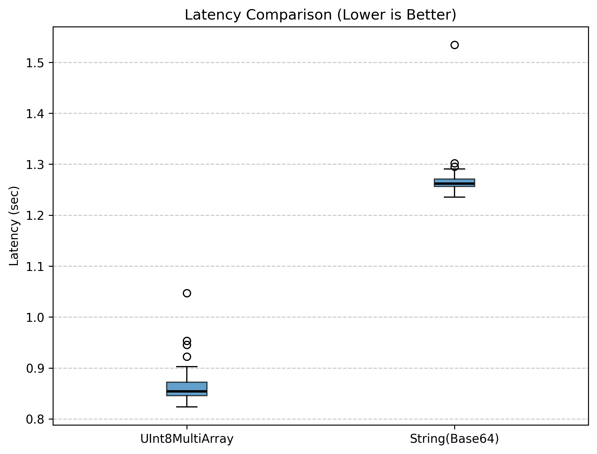
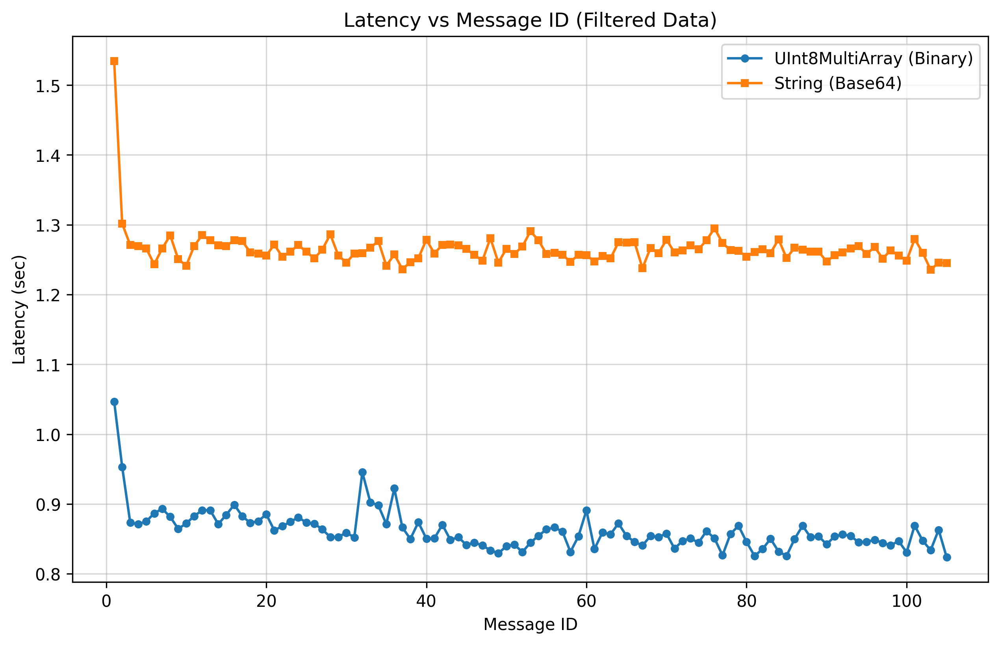
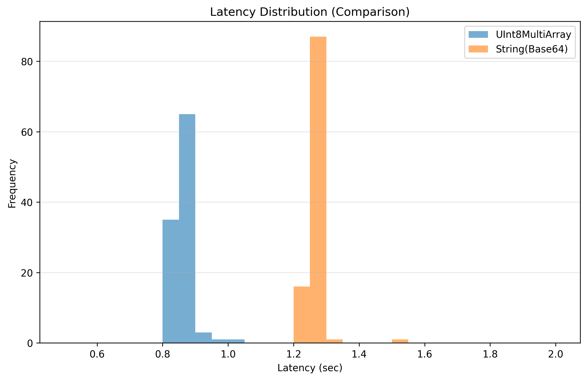
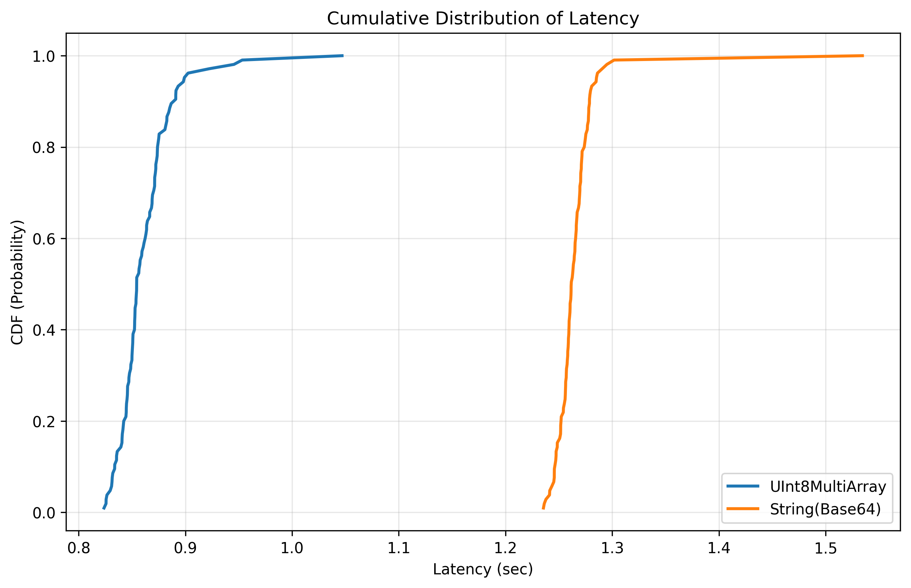

# ROS 2 Latency Benchmark: UInt8MultiArray vs. String Base 64 Encoding

This project benchmarks the performance of two different data transmission methods in ROS 2 when handling large payloads (150 MB).
We consider the data to be a numpy array. The experiment setup is at the moment to run both publisher and subscriber on the same machine.

## Comparison Overview
We compared **UInt8MultiArray** (Raw Binary) against **String Base64** (Text Encoding). The goal was to measure the "Latency" as the time it takes for a message to travel from the Publisher to the Subscriber.

### The Results at a Glance
| Metric | UInt8MultiArray (Binary) | String (Base64) |
| :--- | :--- | :--- |
| **Payload Size** | 150 MB | 150 MB |
| **Transmission Size** | ~150 MB | ~200 MB (33% overhead) |
| **Average Latency** | **0.893 seconds** | **1.282 seconds** |
| **Performance Gain** | **30.3% Faster** | - |

---

## Key Findings

### Speed & Efficiency
The **UInt8MultiArray** is significantly faster. Because it sends raw bytes, the computer does not have to spend time "translating" the data. The **Base64** method, however, must encode the numpy array data into text and then decode it back, adding roughly **0.4 seconds** of unnecessary delay to every message.

### Stability (Jitter)
As seen in the **Latency vs. Message ID** plots:
- **Binary (Blue):** Very stable and predictable.
- **Base64 (Orange):** Shows more "jitter" (spikes in latency), likely due to the heavy CPU work required for decoding large strings.

## Visualization Summary

* **Box Plot:** Shows that the "worst-case" scenario for Binary is still faster than the "best-case" scenario for Base64.
* **Histogram:** Displays two distinct groups. The Binary group is tightly packed on the left (faster), while the Base64 group is wider and shifted to the right (slower).
* **CDF Plot:** Proves that 100% of binary messages are delivered before the text-encoded messages even begin to finish.

## Conclusion
For high-performance robotics applications involving large data (like high-res camera feeds or LiDAR point clouds), **UInt8MultiArray** is the superior choice. It reduces latency by over 30% and minimizes CPU and network usage.