# ROS 2 Latency Benchmark: UInt8MultiArray vs. String Base64 (numpy array) — Ethernet

This project benchmarks the performance of two data transmission methods in ROS2 Jazzy version when handling large payloads (**150 MB**). The data represents a `float32` NumPy array.

Both X86 machines are connected to the network via **Ethernet** cable.

**Experiment Setup:**
* **Payload:** 150 MB (randomly generated `float32` array).
* **Environment:** Publisher runs on one X86 machine and Subscriber runs on another X86 machine.
* **Network Type:** Local Network (Ethernet)

---

## Experiment
We compared **UInt8MultiArray** (Raw Binary) against **String Base64** (Text Encoding). The goal was to measure **Latency**—the total time from message publication to successful receipt and reconstruction.

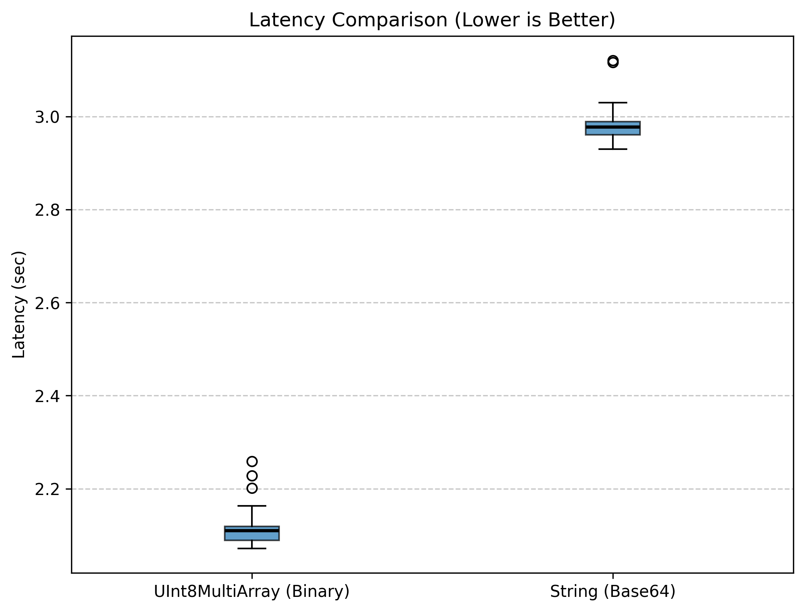

### The Results at a Glance
| Metric | UInt8MultiArray (Binary) | String (Base64) |
| :--- | :--- | :--- |
| **Payload Size** | 150 MB | 150 MB |
| **Transmission Size** | ~150 MB | ~200 MB (33% overhead) |
| **Average Latency** | **2.1086 seconds** | **2.9777 seconds** |
| **Performance Gain** | **~29.2% Faster** | - |

---

## Key Findings

### 1. Speed & Efficiency: Ethernet Bandwidth Advantage
Over a wired Ethernet link, the **UInt8MultiArray** method confirms its advantage seen in the WiFi experiments—and at dramatically lower absolute latencies (~2.1s vs ~8.7s on WiFi). The higher available bandwidth of Ethernet allows both methods to transfer the payload faster, but the Binary method's smaller 150 MB footprint still delivers a consistent ~29.2% gain over Base64.

The **String (Base64)** method continues to pay a "Serialization Tax": the CPU must transform every byte into an ASCII character, inflating the payload to ~200 MB. Even on a fast Ethernet connection this extra 50 MB adds nearly **0.87 seconds** of unnecessary overhead per message.

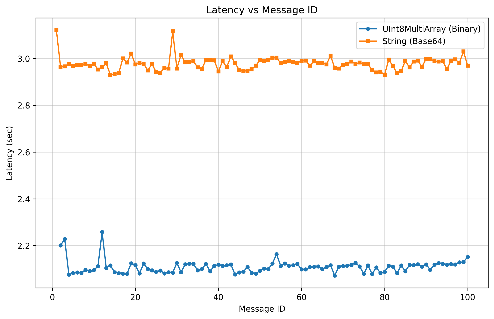
*Note: Both methods reach a stable operating point almost immediately with no warm-up effect, benefiting from Ethernet's low jitter.*

### 2. Stability & Jitter
Ethernet provides a remarkably stable transmission environment for both methods:

* **UInt8MultiArray (Blue):** Exceptionally tight distribution. The histogram shows a narrow cluster around **2.1s** with very low variance (std ≈ 0.028s), indicating a highly predictable channel.
* **String (Base64) (Orange):** Also stable compared to WiFi, but the distribution is centered ~0.87s higher and slightly wider, reflecting variable CPU time for Base64 encoding/decoding.

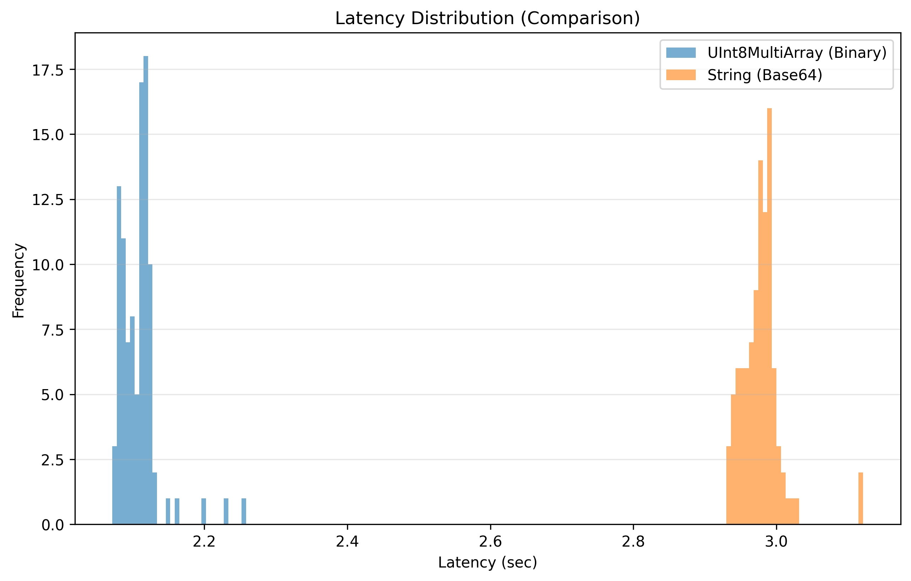

---

### Visualization Summary

* **Box Plot:** Both IQRs are extremely narrow (Ethernet eliminates network-induced jitter), but the Binary box sits entirely below the String box with no overlap.
* **Histogram:** Two distinct, non-overlapping peaks. Binary is tightly clustered at ~2.1s while String is concentrated at ~2.97s. The separation is clean and deterministic.
* **CDF Plot:** Confirms that **100%** of Binary messages complete before the first String message arrives, even over a fast Ethernet link.

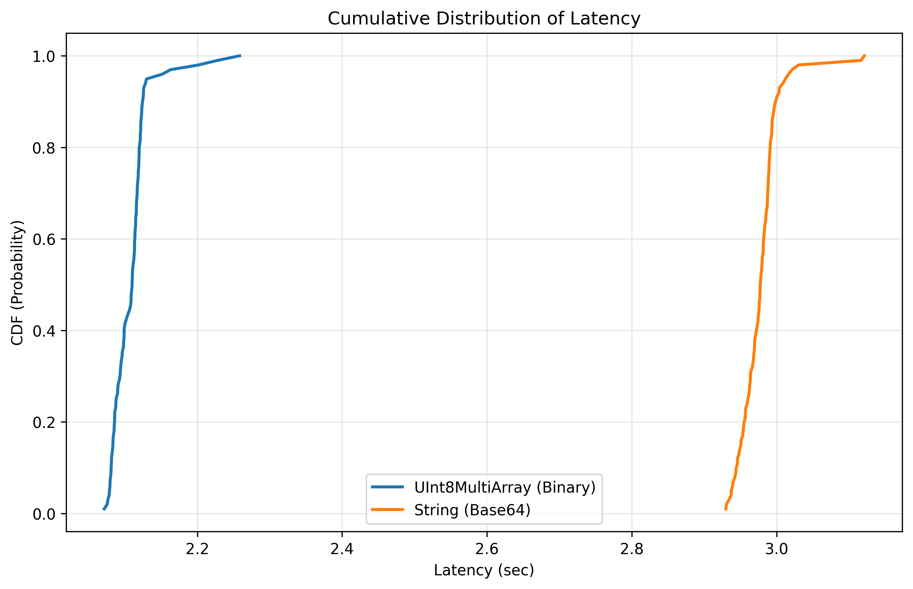

---

## Comparison with WiFi (X86 + X86)

| Metric | Ethernet (Binary) | WiFi (Binary) | Ethernet (String) | WiFi (String) |
| :--- | :--- | :--- | :--- | :--- |
| **Average Latency** | **2.1086s** | 8.6934s | **2.9777s** | 11.0463s |
| **Speedup vs WiFi** | **~4.1×** | - | **~3.7×** | - |

Ethernet delivers approximately **4× lower latency** for the Binary method. The Binary advantage holds in both network environments, confirming that the serialization overhead (not the network medium) determines the winner.

---

## Final Conclusion

Over Ethernet, **UInt8MultiArray (Binary)** is still the mandatory choice for high-bandwidth ROS 2 applications:

* **Physical Bandwidth Ceiling:** Even on fast wired networks, keeping the payload at 150 MB rather than 200 MB reduces the number of packets in flight, minimizes the probability of buffer stalls, and ensures more deterministic arrival times.
* **CPU Tax Remains:** The Base64 encoding/decoding overhead is a fixed CPU cost independent of the network medium. On Ethernet it is still ~0.87s of wasted compute per message.
* **Ethernet vs WiFi:** The absolute latency improvement (4× lower) from switching to Ethernet is larger than the relative gain from choosing the right message type (~29%). For latency-critical systems, both choices compound: use Ethernet **and** UInt8MultiArray.

**Recommendation:** For AI tensors over any network medium, UInt8MultiArray is optimal. The convenience of String types is outweighed by both the serialization CPU tax and the transmission bandwidth penalty.

---

# ROS 2 Latency Benchmark: UInt8MultiArray vs. String Base64 (list of numpy arrays) — Ethernet

This section benchmarks the same two methods when handling **~150 MB payloads as a list of `float32` NumPy arrays**.
The shapes of the numpy arrays are:

```python
self.shapes = [
    (1, 120, 160, 5, 64),
    (1, 120, 160, 5, 64, 3),
    (1, 120, 160, 6),
    (1, 120, 160)
]
```

**Experiment Setup:**
* **Payload:** ~150 MB (list of generated `float32` numpy arrays).
* **Environment:** Publisher runs on one X86 machine and Subscriber runs on another X86 machine.
* **Network Type:** Local Network (Ethernet)

---

## Experiment
We compared **UInt8MultiArray** (Raw Binary) against **String Base64** (Text Encoding). The goal was to measure **Latency**—the total time from message publication to successful receipt and reconstruction.

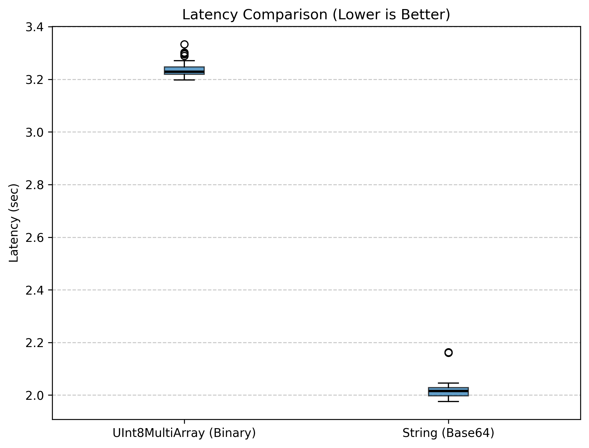

### The Results at a Glance
| Metric | UInt8MultiArray (Binary) | String (Base64) |
| :--- | :--- | :--- |
| **Payload Size** | ~150 MB | ~150 MB |
| **Transmission Size** | ~150 MB | ~200 MB (33% overhead) |
| **Average Latency** | **3.2343 seconds** | **2.0153 seconds** |
| **Performance Gain** | - | **~37.7% Faster** |

---

## Key Findings

### 1. Speed & Efficiency: The "Packing Overhead Tax" Over Fast Networks
The result is **reversed** compared to the single-array benchmark. Over Ethernet—a fast, low-jitter medium—the **String (Base64)** method is significantly faster. This mirrors the same-machine WiFi result and stems from the same root cause: the cost of concatenating multiple separate array chunks into a single flat UInt8MultiArray payload dominates when network transmission time is short.

With Ethernet delivering ~4× lower latency than WiFi, the network bottleneck is reduced further, and the packing overhead of the Binary method (~1.2s of constant serialization cost) becomes the dominant factor. String sidesteps this by encoding each array chunk independently, keeping the per-message overhead more manageable.

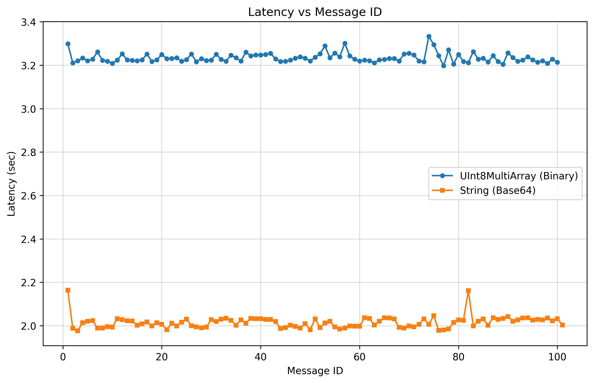
*Note: The binary method runs as a near-flat line at ~3.2s, while String fluctuates narrowly around 2.0s with minimal jitter.*

### 2. Stability & Jitter
While String is faster in this configuration, the binary method remains highly predictable:

* **UInt8MultiArray (Blue):** Near-zero variance. The histogram forms an ultra-narrow, tall tower tightly packed at the ~3.2s mark, indicating a completely deterministic serialization and transmission process.
* **String (Base64) (Orange):** Faster overall, but with slightly more spread. The distribution ranges from ~1.98s to ~2.16s, reflecting minor variability in Base64 encoding time for the individual array chunks.

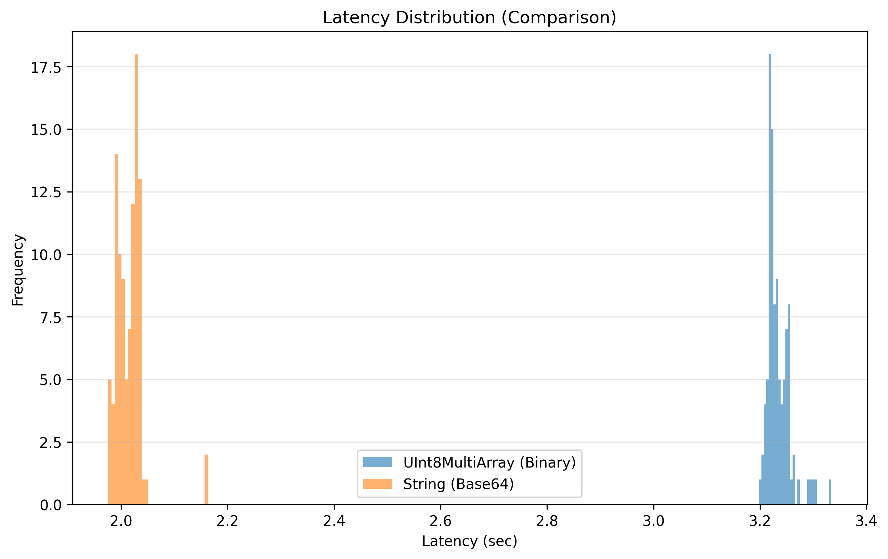

---

### Visualization Summary

* **Box Plot:** The Binary IQR is microscopically narrow (~3.20s–3.24s), while the String box sits entirely below it (~1.99s–2.04s). There is no overlap between the two methods.
* **Histogram:** Two completely non-overlapping populations. String (orange) is concentrated between 1.98s and 2.16s; Binary (blue) forms a tight tower at 3.2s.
* **CDF Plot:** Full separation—100% of String messages complete before the first Binary message arrives.

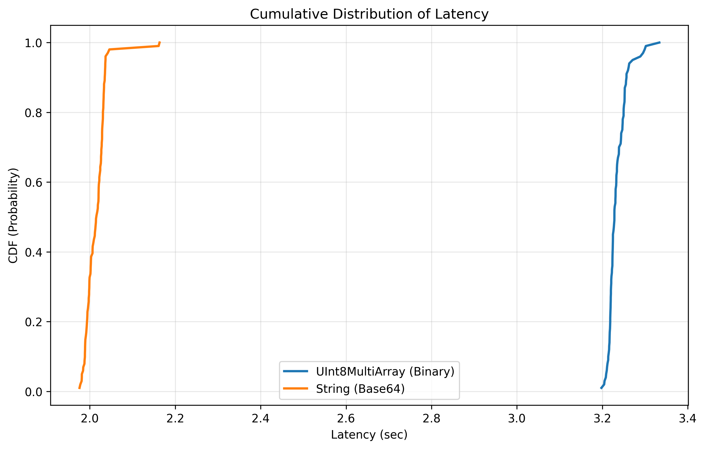

---

## Comparison with WiFi (X86 + X86)

| Metric | Ethernet (Binary) | WiFi (Binary) | Ethernet (String) | WiFi (String) |
| :--- | :--- | :--- | :--- | :--- |
| **Average Latency** | 3.2343s | 8.3911s | **2.0153s** | 10.5983s |
| **Winner** | String by 37.7% | Binary by 20.8% | - | - |

The winner **flips between Ethernet and WiFi**. On WiFi, the 33% payload reduction of Binary is enough to overcome the packing overhead. On Ethernet, the fast link reduces transmission time so much that the packing overhead of Binary dominates, handing the win back to String—matching the same-machine WiFi result.

---

## Final Conclusion

The list of numpy arrays benchmark reveals a network-speed-dependent inversion:

* **Over Ethernet (fast link):** **String (Base64) is ~37.7% faster.** The network is fast enough that the 33% payload reduction from Binary no longer offsets the constant packing overhead of assembling multiple array chunks. Ethernet effectively "closes the gap" between local and networked execution for this use case.
* **Over WiFi (slower link):** Binary recovers its advantage (~20.8% faster) because the network becomes the bottleneck and the smaller 150 MB payload directly reduces transmission time.

**Recommendation:** For multi-array AI tensor transmission over Ethernet, String (Base64) delivers lower latency—but only when the destination machine has sufficient CPU to handle decoding without overload. For any deployment where network bandwidth is limited (WiFi, long-haul, constrained links) or where the receiving end is resource-constrained (ARM edge devices), UInt8MultiArray remains the safer choice.

---

# Non-ROS Alternatives Benchmark: Arrow IPC vs. Arrow Flight vs. gRPC String — Ethernet

This section benchmarks three non-ROS transport methods for transmitting the same **150 MB** `float32` array between X86 machines over Ethernet. All three bypass the ROS 2 DDS middleware entirely.

* **Arrow IPC + TCP:** Serializes the array using Apache Arrow's IPC format and streams it over a raw TCP socket.
* **Arrow Flight (gRPC):** Uses Apache Arrow Flight, which wraps Arrow IPC over gRPC for structured, bidirectional streaming.
* **gRPC String (bytes):** Streams the raw `float32` array bytes as a protobuf `bytes` field inside a server-side streaming gRPC call.

**Experiment Setup:**
* **Payload:** 150 MB (randomly generated `float32` array — same as ROS benchmarks).
* **Environment:** Server runs on one X86 machine, client on another X86 machine.
* **Network Type:** Local Network (Ethernet)

---

## Experiment
We compared all three non-ROS methods and set the results against the best ROS 2 method (UInt8MultiArray, 2.1086s).

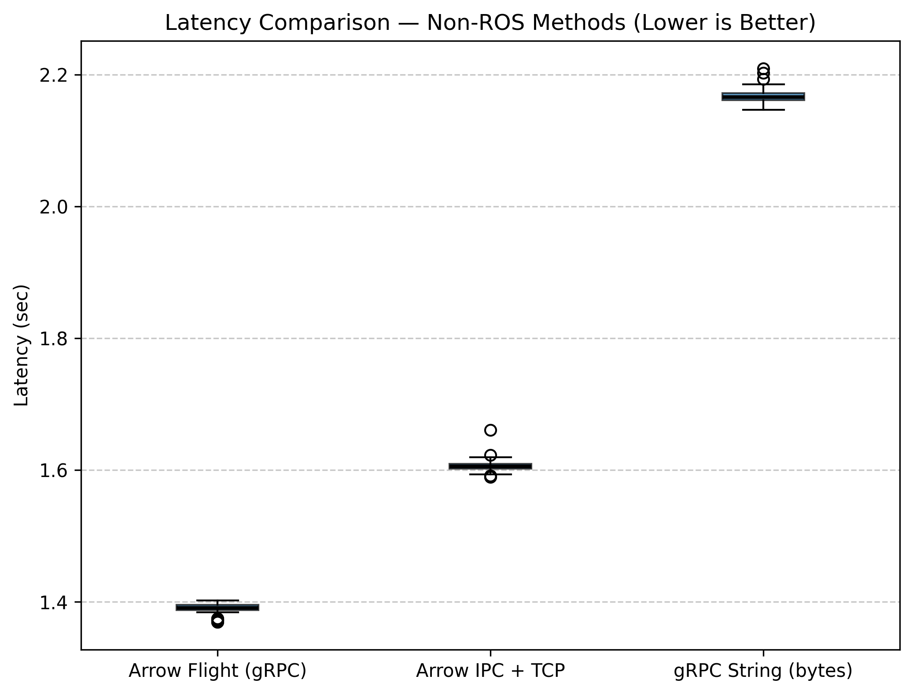

### The Results at a Glance
| Metric | Arrow Flight (gRPC) | Arrow IPC + TCP | gRPC String (bytes) | ROS2 UInt8MultiArray |
| :--- | :--- | :--- | :--- | :--- |
| **Payload Size** | 150 MB | 150 MB | 150 MB | 150 MB |
| **Average Latency** | **1.3901 seconds** | **1.6057 seconds** | **2.1671 seconds** | 2.1086 seconds |
| **vs. ROS2 Binary** | **~34.1% Faster** | **~23.9% Faster** | ~2.8% Slower | - |

---

## Key Findings

### 1. Speed: Arrow Format vs. Raw gRPC Framing
The results reveal a clear hierarchy driven by how efficiently each method frames the 150 MB payload.

**Arrow Flight** is the fastest at 1.39s. It combines Apache Arrow's columnar IPC format with gRPC's HTTP/2 streaming, benefiting from built-in flow control and backpressure that efficiently pipelines large binary chunks. Arrow Flight beats raw Arrow IPC despite adding gRPC overhead, which indicates that its streaming protocol is better suited to large contiguous payloads than a plain TCP stream.

**Arrow IPC + TCP** lands at 1.61s. The simpler stack (raw socket + Arrow IPC stream) eliminates protocol framing overhead but loses the pipelining optimizations of Flight. It still beats all ROS 2 methods by ~24%.

**gRPC String (bytes)** at 2.17s is the slowest of the three non-ROS methods and performs comparably to ROS2 UInt8MultiArray (2.11s). While it bypasses DDS, the overhead of wrapping the 150 MB payload as a single protobuf `bytes` field—which gRPC must buffer and length-prefix in full before sending—offsets the savings from removing the middleware layer. This confirms that gRPC alone does not solve the large-payload problem; the Arrow columnar format and its streaming API are what make Arrow IPC and Flight fast.

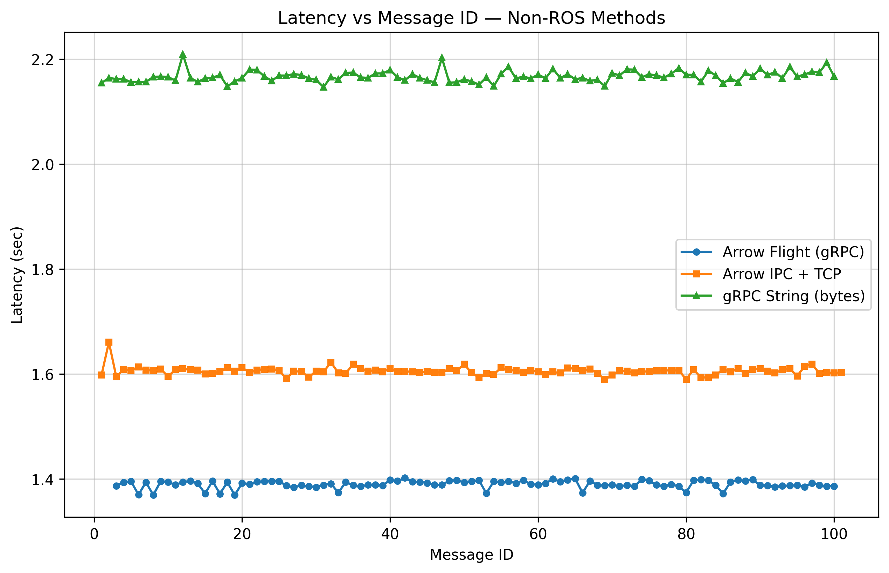
*Note: All three methods show stable, near-flat latency from the first message—direct socket/gRPC connections establish faster than DDS discovery.*

### 2. Stability & Jitter
All three non-ROS methods are more stable than ROS 2, but the degree varies significantly:

* **Arrow Flight (gRPC):** Tightest of all. Clustered around **1.39s** (std ≈ 0.008s). Near-perfect determinism across every message.
* **Arrow IPC + TCP:** Very tight cluster around **1.61s** (std ≈ 0.008s). Raw TCP with a tuned socket buffer provides highly deterministic delivery.
* **gRPC String (bytes):** Tighter than any ROS 2 method at **2.17s** (std ≈ 0.010s), but notably slower than the Arrow-based approaches. The single-message protobuf framing limits the protocol's ability to pipeline and overlap transfer with processing.

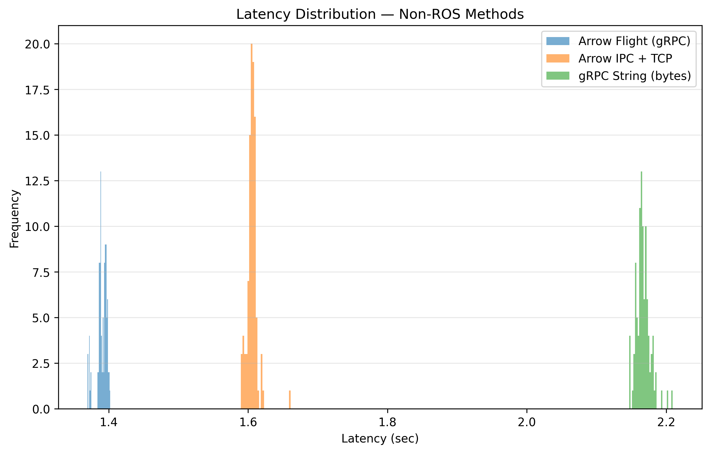

---

### Visualization Summary

* **Box Plot:** Three distinct, non-overlapping IQRs ordered by method. Arrow Flight sits lowest, followed by Arrow IPC, with gRPC String in a separate band near the ROS2 UInt8MultiArray level.
* **Histogram:** Three separate peaks with no overlap between them. Arrow Flight and Arrow IPC form very tall, narrow towers at 1.39s and 1.61s respectively; gRPC String spreads slightly wider around 2.17s.
* **CDF Plot:** Arrow Flight completes 100% of messages before Arrow IPC reaches 50%; both Arrow methods complete 100% before gRPC String begins. The step-function shape of all three curves confirms near-deterministic latency for every method.

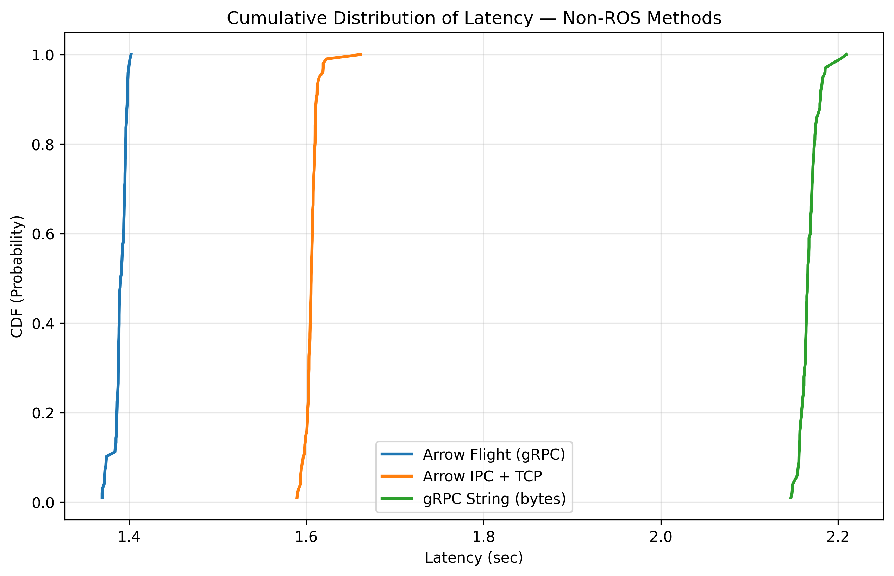

---

## Overall Method Comparison (Ethernet, X86 + X86)

| Method | Type | Avg Latency | vs. Slowest |
| :--- | :--- | :--- | :--- |
| **Arrow Flight (gRPC)** | Non-ROS | **1.3901s** | **53.3% Faster** |
| **Arrow IPC + TCP** | Non-ROS | **1.6057s** | **46.1% Faster** |
| **ROS2 UInt8MultiArray** | ROS2 | 2.1086s | 29.2% Faster |
| **gRPC String (bytes)** | Non-ROS | 2.1671s | 27.3% Faster |
| **ROS2 String (Base64)** | ROS2 | 2.9777s | — |

---

## Final Conclusion

The non-ROS comparison shows that **bypassing DDS is necessary but not sufficient** to achieve low latency—the choice of wire format and streaming protocol matters just as much.

* **Arrow Flight** is the fastest method tested overall, combining Apache Arrow's zero-copy columnar format with gRPC's efficient bidirectional streaming. For minimum latency on Ethernet, it is the clear top choice.
* **Arrow IPC + TCP** delivers nearly the same performance with a simpler stack. It is a strong alternative when avoiding the gRPC dependency is preferred.
* **gRPC String (bytes)** is a cautionary result: removing DDS does not automatically yield a speed advantage. Wrapping a 150 MB blob as a single protobuf `bytes` field negates the savings from bypassing middleware, landing at the same latency tier as ROS2 UInt8MultiArray. The Arrow columnar format—not gRPC itself—is responsible for the performance gains of Arrow Flight.
* **ROS2 UInt8MultiArray** remains the best choice within the ROS 2 ecosystem. It matches gRPC String in raw latency while retaining all ecosystem benefits (topic introspection, launch files, bag recording, etc.).

**Recommendation:** If ROS 2 integration is not required and minimum latency is the priority, Arrow Flight over Ethernet is the optimal transport for 150 MB float32 tensor payloads between X86 machines. If a non-ROS gRPC-based solution is needed without the Arrow dependency, expect performance comparable to ROS2 UInt8MultiArray—not better.
