# ROS 2 Latency Benchmark: UInt8MultiArray vs. String Base64 (numpy array) — Ethernet

This project benchmarks the performance of two data transmission methods in ROS2 Jazzy version when handling large payloads (**150 MB**). The data represents a `float32` NumPy array.

Both machines are connected to the network via **Ethernet** cable.

**First Experiment Setup:**
* **Payload:** 150 MB (randomly generated `float32` array).
* **Environment:** Publisher runs on one X86 machine and Subscriber runs on another X86 machine.
* **Network Type:** Local Network (Ethernet)

**Second Experiment Setup:**
* **Payload:** 150 MB (randomly generated `float32` array).
* **Environment:** Publisher runs on one X86 machine and Subscriber runs on a Jetson Nano.
* **Network Type:** Local Network (Ethernet)

---

## First Experiment
We compared **UInt8MultiArray** (Raw Binary) against **String Base64** (Text Encoding). The goal was to measure **Latency**—the total time from message publication to successful receipt and reconstruction.


### The Results at a Glance
| Metric | UInt8MultiArray (Binary) | String (Base64) |
| :--- | :--- | :--- |
| **Payload Size** | 150 MB | 150 MB |
| **Transmission Size** | ~150 MB | ~200 MB (33% overhead) |
| **Average Latency** | **2.1086 seconds** | **2.9777 seconds** |
| **Performance Gain** | **~29.2% Faster** | - |

---

## Key Findings

### 1. Speed & Efficiency: Ethernet Bandwidth Advantage
Over a wired Ethernet link, the **UInt8MultiArray** method confirms its advantage seen in the WiFi experiments—and at dramatically lower absolute latencies (~2.1s vs ~8.7s on WiFi). The higher available bandwidth of Ethernet allows both methods to transfer the payload faster, but the Binary method's smaller 150 MB footprint still delivers a consistent ~29.2% gain over Base64.

The **String (Base64)** method continues to pay a "Serialization Tax": the CPU must transform every byte into an ASCII character, inflating the payload to ~200 MB. Even on a fast Ethernet connection this extra 50 MB adds nearly **0.87 seconds** of unnecessary overhead per message.


*Note: Both methods reach a stable operating point almost immediately with no warm-up effect, benefiting from Ethernet's low jitter.*

### 2. Stability & Jitter
Ethernet provides a remarkably stable transmission environment for both methods:

* **UInt8MultiArray (Blue):** Exceptionally tight distribution. The histogram shows a narrow cluster around **2.1s** with very low variance (std ≈ 0.028s), indicating a highly predictable channel.
* **String (Base64) (Orange):** Also stable compared to WiFi, but the distribution is centered ~0.87s higher and slightly wider, reflecting variable CPU time for Base64 encoding/decoding.


---

### Visualization Summary

* **Box Plot:** Both IQRs are extremely narrow (Ethernet eliminates network-induced jitter), but the Binary box sits entirely below the String box with no overlap.
* **Histogram:** Two distinct, non-overlapping peaks. Binary is tightly clustered at ~2.1s while String is concentrated at ~2.97s. The separation is clean and deterministic.
* **CDF Plot:** Confirms that **100%** of Binary messages complete before the first String message arrives, even over a fast Ethernet link.


---

## Second Experiment
We compared **UInt8MultiArray** (Raw Binary) against **String Base64** (Text Encoding) across an X86 publisher and a **Jetson Nano** subscriber connected via Ethernet. The goal was to measure **Latency**—the total time from message publication to successful receipt and reconstruction.

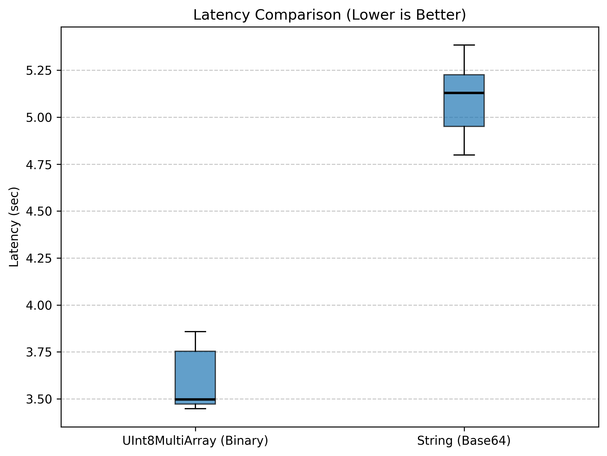

### The Results at a Glance
| Metric | UInt8MultiArray (Binary) | String (Base64) |
| :--- | :--- | :--- |
| **Payload Size** | 150 MB | 150 MB |
| **Transmission Size** | ~150 MB | ~200 MB (33% overhead) |
| **Average Latency** | **3.5886 seconds** | **5.0823 seconds** |
| **Performance Gain** | **~29.4% Faster** | - |

---

## Key Findings

### 1. Speed & Efficiency: ARM Hardware as the New Bottleneck
With the Jetson Nano as the subscriber, the **UInt8MultiArray** advantage holds—and at the same ~29% margin seen in the X86+X86 case. The Ethernet link is fast enough in both cases that the primary cost driver is not the network itself but the payload volume: Binary transmits 150 MB; Base64 forces 200 MB through the interface and into the Jetson's constrained memory bus.

The **String (Base64)** method imposes a double penalty on the Jetson Nano: the CPU must mathematically decode every Base64 character back to binary while the network interface simultaneously handles the 33% extra data. Even on a fast wired link this adds **~1.5 seconds** of overhead per message compared to Binary.

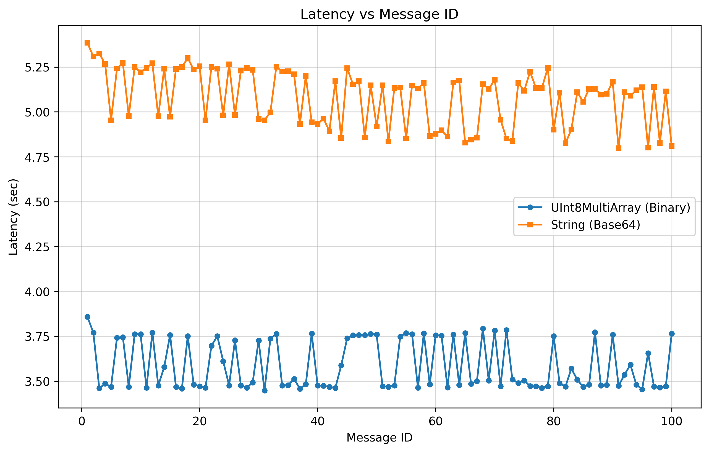
*Note: Both methods are stable from the first message. The Jetson Nano's limited CPU is reflected in the higher absolute latencies (~3.6s and ~5.1s) compared to the X86+X86 case (~2.1s and ~3.0s).*

### 2. Stability & Jitter
Ethernet keeps both methods well-behaved even on the constrained Jetson Nano:

* **UInt8MultiArray (Blue):** Tight bimodal distribution around **3.45s** and **3.76s** (std ≈ 0.136s), reflecting the Jetson Nano's alternating fast and slow receive cycles as it processes the large DMA transfer. Overall variance remains low.
* **String (Base64) (Orange):** Clustered around **4.85s–5.3s** (std ≈ 0.156s), slightly wider than Binary due to variable Base64 decoding time on the ARM cores.

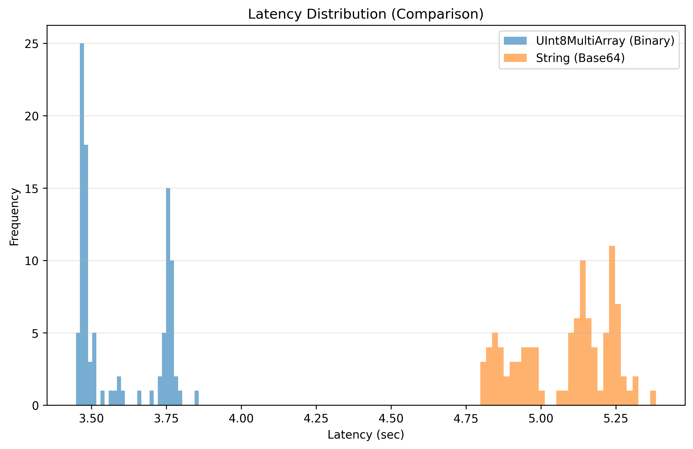

---

### Visualization Summary

* **Box Plot:** The Binary IQR sits entirely below the String IQR with no overlap, mirroring the X86+X86 result. Both boxes are narrow compared to WiFi experiments.
* **Histogram:** Two distinct, non-overlapping populations. Binary has a bimodal shape tightly packed below 3.9s; String is concentrated in the 4.8s–5.4s band.
* **CDF Plot:** Confirms full separation—100% of Binary messages complete before the first String message arrives, even with a Jetson Nano as the subscriber.

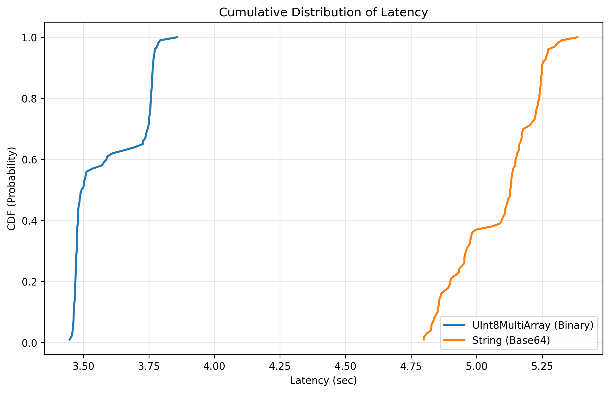

---

## Comparison: X86+X86 vs X86+Jetson Nano (Ethernet)

| Metric | Ethernet x86 (Binary) | Ethernet Jetson (Binary) | Ethernet x86 (String) | Ethernet Jetson (String) |
| :--- | :--- | :--- | :--- | :--- |
| **Average Latency** | **2.1086s** | 3.5886s | **2.9777s** | 5.0823s |
| **vs WiFi equivalent** | ~4.1× faster | ~4.6× faster | ~3.7× faster | ~4.9× faster |

Switching from X86+X86 to X86+Jetson Nano over Ethernet increases latency by ~70% (Binary) and ~71% (String). The Jetson Nano's limited CPU and memory bandwidth—not the Ethernet link—is the bottleneck in both cases. However, Ethernet eliminates the WiFi network jitter entirely, so even the Jetson Nano achieves dramatically more stable delivery than any WiFi scenario.

---

## Final Conclusion

Over Ethernet, **UInt8MultiArray (Binary)** is the mandatory choice for high-bandwidth ROS 2 applications in both hardware configurations:

* **X86 + X86:** Both machines handle the binary payload with minimal overhead. Binary transmits 150 MB deterministically in ~2.1s; Base64 wastes ~0.87s per message in unnecessary CPU encoding.
* **X86 + Jetson Nano:** The ARM CPU and constrained memory bus make the 33% payload reduction of Binary even more impactful. Ethernet keeps jitter low for both methods, but Binary finishes ~1.5s sooner per message, freeing the Jetson for inference tasks.
* **Ethernet vs WiFi:** The absolute latency improvement (4–5× lower) from switching to Ethernet is larger than the relative gain from choosing the right message type (~29%). For latency-critical systems, both choices compound: use Ethernet **and** UInt8MultiArray.

**Recommendation:** For AI tensors over any Ethernet network, UInt8MultiArray is optimal regardless of subscriber hardware. The serialization CPU tax and bandwidth penalty of String types are inescapable—even a fast wired link cannot hide them.

---

# ROS 2 Latency Benchmark: UInt8MultiArray vs. String Base64 (list of numpy arrays) — Ethernet

This section benchmarks the same two methods when handling **~150 MB payloads as a list of `float32` NumPy arrays**.
The shapes of the numpy arrays are:

```python
self.shapes = [
    (1, 120, 160, 5, 64),
    (1, 120, 160, 5, 64, 3),
    (1, 120, 160, 6),
    (1, 120, 160)
]
```

**First Experiment Setup:**
* **Payload:** ~150 MB (list of generated `float32` numpy arrays).
* **Environment:** Publisher runs on one X86 machine and Subscriber runs on another X86 machine.
* **Network Type:** Local Network (Ethernet)

**Second Experiment Setup:**
* **Payload:** ~150 MB (list of generated `float32` numpy arrays).
* **Environment:** Publisher runs on one X86 machine and Subscriber runs on a Jetson Nano.
* **Network Type:** Local Network (Ethernet)

---

## First Experiment
We compared **UInt8MultiArray** (Raw Binary) against **String Base64** (Text Encoding). The goal was to measure **Latency**—the total time from message publication to successful receipt and reconstruction.


### The Results at a Glance
| Metric | UInt8MultiArray (Binary) | String (Base64) |
| :--- | :--- | :--- |
| **Payload Size** | ~150 MB | ~150 MB |
| **Transmission Size** | ~150 MB | ~200 MB (33% overhead) |
| **Average Latency** | **3.2343 seconds** | **2.0153 seconds** |
| **Performance Gain** | - | **~37.7% Faster** |

---

## Key Findings

### 1. Speed & Efficiency: The "Packing Overhead Tax" Over Fast Networks
The result is **reversed** compared to the single-array benchmark. Over Ethernet—a fast, low-jitter medium—the **String (Base64)** method is significantly faster. This mirrors the same-machine WiFi result and stems from the same root cause: the cost of concatenating multiple separate array chunks into a single flat UInt8MultiArray payload dominates when network transmission time is short.

With Ethernet delivering ~4× lower latency than WiFi, the network bottleneck is reduced further, and the packing overhead of the Binary method (~1.2s of constant serialization cost) becomes the dominant factor. String sidesteps this by encoding each array chunk independently, keeping the per-message overhead more manageable.


*Note: The binary method runs as a near-flat line at ~3.2s, while String fluctuates narrowly around 2.0s with minimal jitter.*

### 2. Stability & Jitter
While String is faster in this configuration, the binary method remains highly predictable:

* **UInt8MultiArray (Blue):** Near-zero variance. The histogram forms an ultra-narrow, tall tower tightly packed at the ~3.2s mark, indicating a completely deterministic serialization and transmission process.
* **String (Base64) (Orange):** Faster overall, but with slightly more spread. The distribution ranges from ~1.98s to ~2.16s, reflecting minor variability in Base64 encoding time for the individual array chunks.


---

### Visualization Summary

* **Box Plot:** The Binary IQR is microscopically narrow (~3.20s–3.24s), while the String box sits entirely below it (~1.99s–2.04s). There is no overlap between the two methods.
* **Histogram:** Two completely non-overlapping populations. String (orange) is concentrated between 1.98s and 2.16s; Binary (blue) forms a tight tower at 3.2s.
* **CDF Plot:** Full separation—100% of String messages complete before the first Binary message arrives.


---

## Second Experiment
We compared **UInt8MultiArray** (Raw Binary) against **String Base64** (Text Encoding) across an X86 publisher and a **Jetson Nano** subscriber connected via Ethernet. The goal was to measure **Latency**—the total time from message publication to successful receipt and reconstruction.

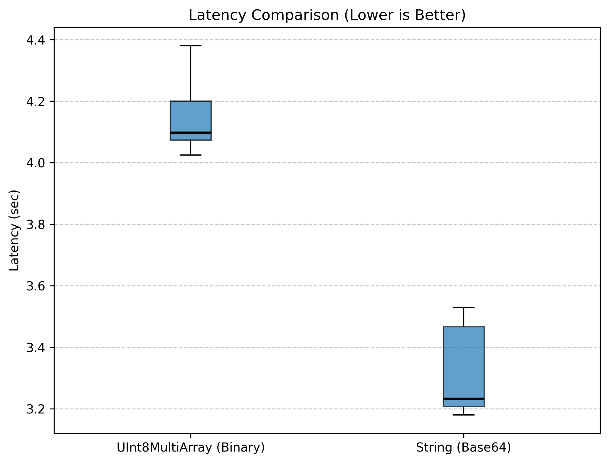

### The Results at a Glance
| Metric | UInt8MultiArray (Binary) | String (Base64) |
| :--- | :--- | :--- |
| **Payload Size** | ~150 MB | ~150 MB |
| **Transmission Size** | ~150 MB | ~200 MB (33% overhead) |
| **Average Latency** | **4.1493 seconds** | **3.3067 seconds** |
| **Performance Gain** | - | **~20.3% Faster** |

---

## Key Findings

### 1. Speed & Efficiency: String Wins Again, But the Gap Narrows
The String (Base64) advantage **persists** even when crossing to the Jetson Nano over Ethernet—but narrows significantly from 37.7% to 20.3%. The root cause is the same: the constant packing overhead of assembling multiple array chunks into one flat UInt8MultiArray payload (~1.2s) still dominates over the network transmission time on a fast Ethernet link.

However, the Jetson Nano's slower ARM cores begin to partially penalize String as well—decoding four separate Base64 chunks on a constrained CPU adds measurable overhead that was invisible on X86. The gap closes from 1.22s (X86+X86) to 0.84s (X86+Jetson), hinting that on an even more constrained receiver the winner would eventually flip back to Binary.

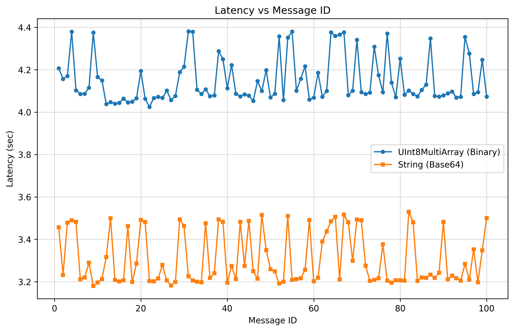
*Note: Both methods show stable delivery with minimal jitter. Binary runs as a near-flat line at ~4.1s; String clusters tightly around 3.2–3.5s.*

### 2. Stability & Jitter
Both methods remain stable on the Jetson Nano over Ethernet:

* **UInt8MultiArray (Blue):** Ultra-tight distribution tightly packed at ~4.1s (std ≈ 0.108s). The constant packing cost produces a near-deterministic flat line per message.
* **String (Base64) (Orange):** Slightly more spread (std ≈ 0.123s) with a bimodal structure around 3.2s and 3.5s, reflecting the Jetson Nano's alternating fast/slow Base64 decode cycles across the four array chunks.

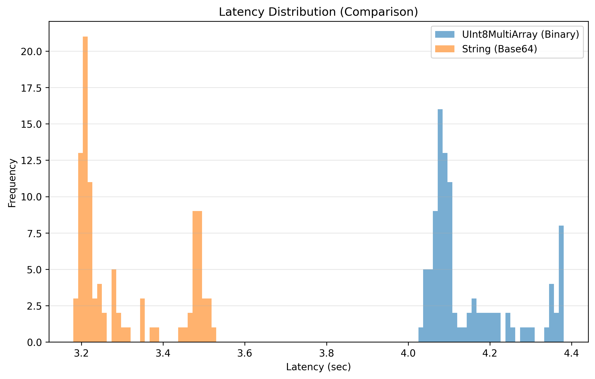

---

### Visualization Summary

* **Box Plot:** The String IQR (~3.2s–3.5s) sits entirely below the Binary IQR (~4.1s), with no overlap.
* **Histogram:** Two distinct populations. String has a bimodal shape concentrated below 3.55s; Binary forms a tight tower at ~4.1s.
* **CDF Plot:** String completes 100% of messages before Binary begins—full separation maintained even on constrained hardware.

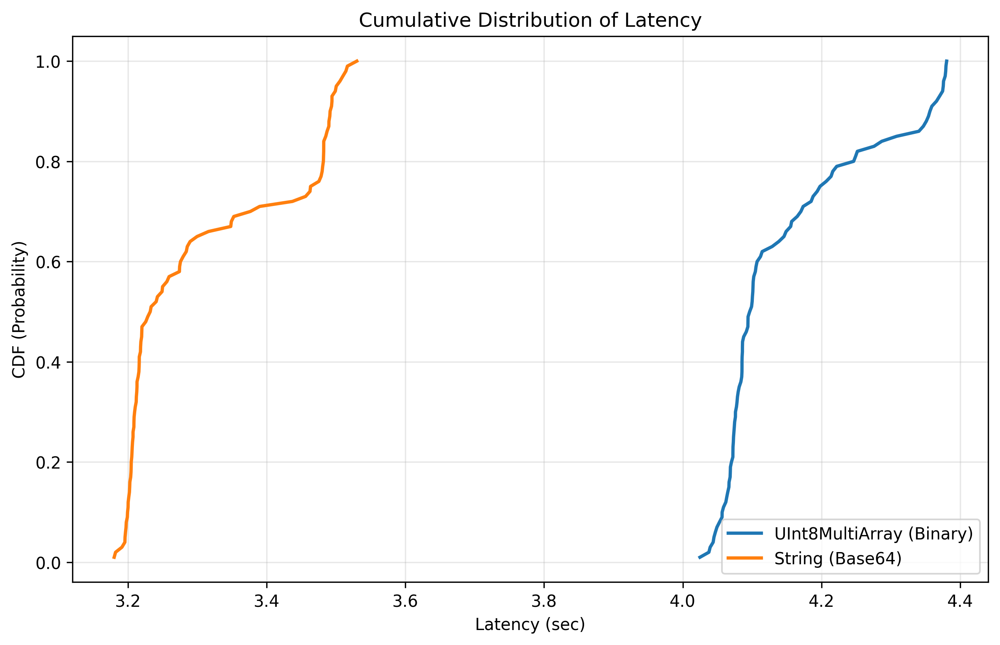

---

## Comparison: X86+X86 vs X86+Jetson Nano (Ethernet)

| Metric | Ethernet x86 (Binary) | Ethernet Jetson (Binary) | Ethernet x86 (String) | Ethernet Jetson (String) |
| :--- | :--- | :--- | :--- | :--- |
| **Average Latency** | 3.2343s | 4.1493s | **2.0153s** | **3.3067s** |
| **Winner** | String by 37.7% | String by 20.3% | - | - |

String wins in both Ethernet configurations, but the **margin shrinks by nearly half** (37.7% → 20.3%) as the Jetson Nano's limited decoding throughput starts to penalize the Base64 approach. This confirms the trend seen across experiments: as subscriber CPU weakens, the packing-overhead advantage of Binary eventually overtakes the Base64 encoding penalty.

---

## Comparison with WiFi (X86 + Jetson Nano)

| Metric | Ethernet (Binary) | WiFi (Binary) | Ethernet (String) | WiFi (String) |
| :--- | :--- | :--- | :--- | :--- |
| **Average Latency** | 4.1493s | 12.9736s | **3.3067s** | 18.7159s |
| **Speedup vs WiFi** | **~3.1×** | - | **~5.7×** | - |

Ethernet delivers ~3–6× lower latency over WiFi for the Jetson Nano scenario, and the winner (String) remains the same—but its margin shrinks as WiFi's larger network penalty amplifies the benefit of Binary's smaller payload.

---

## Final Conclusion

The list of numpy arrays benchmark over Ethernet reveals a nuanced, hardware-dependent picture:

* **X86 + X86 (Ethernet):** **String (Base64) is ~37.7% faster.** The Ethernet link is fast enough that the 33% payload reduction from Binary no longer offsets the constant packing overhead of assembling four array chunks. String encodes each chunk independently, keeping per-message latency at ~2.0s vs Binary's ~3.2s.
* **X86 + Jetson Nano (Ethernet):** **String (Base64) is still ~20.3% faster**, but the gap narrows significantly. The Jetson Nano's ARM cores begin to penalize Base64 decoding, partially eroding String's advantage. If the receiver were more constrained (e.g., an edge MCU), Binary would eventually win.
* **WiFi → Ethernet:** Switching to Ethernet reduces latency by 3–6×, but the winner does not flip for the list-of-arrays case—unlike the single-array case where the winner remains Binary throughout.

**Recommendation:** For multi-array AI tensor transmission over Ethernet, String (Base64) delivers lower latency when the subscriber has sufficient CPU (X86 or comparable). For constrained receivers (Jetson Nano class or weaker) the gap narrows—monitor empirically and switch to UInt8MultiArray if the receiver begins throttling.

---

# Non-ROS Alternatives Benchmark: Arrow IPC vs. Arrow Flight vs. gRPC String — Ethernet

This section benchmarks three non-ROS transport methods for transmitting the same **150 MB** `float32` array between machines over Ethernet. All three bypass the ROS 2 DDS middleware entirely.

* **Arrow IPC + TCP:** Serializes the array using Apache Arrow's IPC format and streams it over a raw TCP socket.
* **Arrow Flight (gRPC):** Uses Apache Arrow Flight, which wraps Arrow IPC over gRPC for structured, bidirectional streaming.
* **gRPC String (bytes):** Streams the raw `float32` array bytes as a protobuf `bytes` field inside a server-side streaming gRPC call.

**First Experiment Setup:**
* **Payload:** 150 MB (randomly generated `float32` array — same as ROS benchmarks).
* **Environment:** Server runs on one X86 machine, client on another X86 machine.
* **Network Type:** Local Network (Ethernet)

**Second Experiment Setup:**
* **Payload:** 150 MB (randomly generated `float32` array).
* **Environment:** Server runs on one X86 machine, client on a Jetson Nano.
* **Network Type:** Local Network (Ethernet)

---

## First Experiment
We compared all three non-ROS methods and set the results against the best ROS 2 method (UInt8MultiArray, 2.1086s).


### The Results at a Glance
| Metric | Arrow Flight (gRPC) | Arrow IPC + TCP | gRPC String (bytes) | ROS2 UInt8MultiArray |
| :--- | :--- | :--- | :--- | :--- |
| **Payload Size** | 150 MB | 150 MB | 150 MB | 150 MB |
| **Average Latency** | **1.3901 seconds** | **1.6057 seconds** | **2.1671 seconds** | 2.1086 seconds |
| **vs. ROS2 Binary** | **~34.1% Faster** | **~23.9% Faster** | ~2.8% Slower | - |

---

## Key Findings

### 1. Speed: Arrow Format vs. Raw gRPC Framing
The results reveal a clear hierarchy driven by how efficiently each method frames the 150 MB payload.

**Arrow Flight** is the fastest at 1.39s. It combines Apache Arrow's columnar IPC format with gRPC's HTTP/2 streaming, benefiting from built-in flow control and backpressure that efficiently pipelines large binary chunks. Arrow Flight beats raw Arrow IPC despite adding gRPC overhead, which indicates that its streaming protocol is better suited to large contiguous payloads than a plain TCP stream.

**Arrow IPC + TCP** lands at 1.61s. The simpler stack (raw socket + Arrow IPC stream) eliminates protocol framing overhead but loses the pipelining optimizations of Flight. It still beats all ROS 2 methods by ~24%.

**gRPC String (bytes)** at 2.17s is the slowest of the three non-ROS methods and performs comparably to ROS2 UInt8MultiArray (2.11s). While it bypasses DDS, the overhead of wrapping the 150 MB payload as a single protobuf `bytes` field—which gRPC must buffer and length-prefix in full before sending—offsets the savings from removing the middleware layer. This confirms that gRPC alone does not solve the large-payload problem; the Arrow columnar format and its streaming API are what make Arrow IPC and Flight fast.


*Note: All three methods show stable, near-flat latency from the first message—direct socket/gRPC connections establish faster than DDS discovery.*

### 2. Stability & Jitter
All three non-ROS methods are more stable than ROS 2, but the degree varies significantly:

* **Arrow Flight (gRPC):** Tightest of all. Clustered around **1.39s** (std ≈ 0.008s). Near-perfect determinism across every message.
* **Arrow IPC + TCP:** Very tight cluster around **1.61s** (std ≈ 0.008s). Raw TCP with a tuned socket buffer provides highly deterministic delivery.
* **gRPC String (bytes):** Tighter than any ROS 2 method at **2.17s** (std ≈ 0.010s), but notably slower than the Arrow-based approaches. The single-message protobuf framing limits the protocol's ability to pipeline and overlap transfer with processing.


---

### Visualization Summary

* **Box Plot:** Three distinct, non-overlapping IQRs ordered by method. Arrow Flight sits lowest, followed by Arrow IPC, with gRPC String in a separate band near the ROS2 UInt8MultiArray level.
* **Histogram:** Three separate peaks with no overlap between them. Arrow Flight and Arrow IPC form very tall, narrow towers at 1.39s and 1.61s respectively; gRPC String spreads slightly wider around 2.17s.
* **CDF Plot:** Arrow Flight completes 100% of messages before Arrow IPC reaches 50%; both Arrow methods complete 100% before gRPC String begins. The step-function shape of all three curves confirms near-deterministic latency for every method.


---

## Second Experiment
We compared all three non-ROS methods with a **Jetson Nano** as the client and set the results against the best ROS 2 method for that hardware configuration (UInt8MultiArray, 3.5886s).

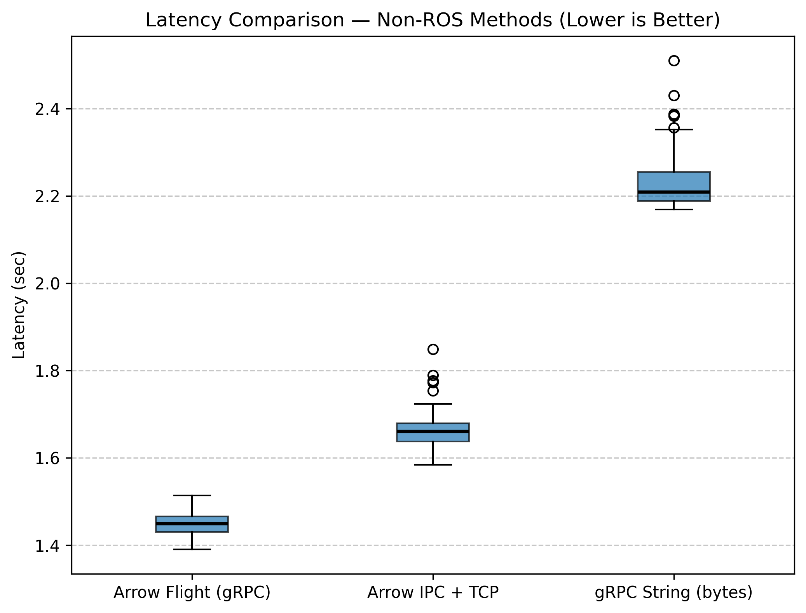

### The Results at a Glance
| Metric | Arrow Flight (gRPC) | Arrow IPC + TCP | gRPC String (bytes) | ROS2 UInt8MultiArray |
| :--- | :--- | :--- | :--- | :--- |
| **Payload Size** | 150 MB | 150 MB | 150 MB | 150 MB |
| **Average Latency** | **1.4472 seconds** | **1.6648 seconds** | **2.2333 seconds** | 3.5886 seconds |
| **vs. ROS2 Binary** | **~59.7% Faster** | **~53.6% Faster** | **~37.8% Faster** | - |

---

## Key Findings

### 1. Speed: Non-ROS Methods Dominate Even More Over Jetson Nano
The hierarchy is identical to the X86+X86 case—Arrow Flight leads, then Arrow IPC, then gRPC String—but the **absolute advantage over ROS2 UInt8MultiArray more than doubles** (34–24% on X86 → 60–38% on Jetson Nano). This is because ROS2 UInt8MultiArray degrades substantially on the Jetson (3.59s vs 2.11s on X86) while the non-ROS methods are barely affected (latencies increase by only ~0.06s each).

The explanation: non-ROS methods use direct socket/gRPC connections that bypass DDS discovery and fragmentation. The Jetson Nano's limited DMA bandwidth handles a single large TCP/gRPC stream efficiently, whereas ROS2 DDS splits the payload into many UDP fragments that must be reassembled under memory pressure on the ARM SoC.

**Arrow Flight** at 1.45s demonstrates that the Jetson Nano's network interface is not the bottleneck—it can sustain near-X86 throughput when the transport is efficient. The ~0.06s increase from X86 reflects only the slightly slower Jetson CPU for Arrow IPC deserialization.

**gRPC String (bytes)** at 2.23s is still ~37.8% faster than ROS2 UInt8MultiArray on Jetson Nano, a gap invisible in the X86+X86 case. This confirms that the DDS middleware overhead—not just payload size—is the differentiating cost factor on constrained hardware.

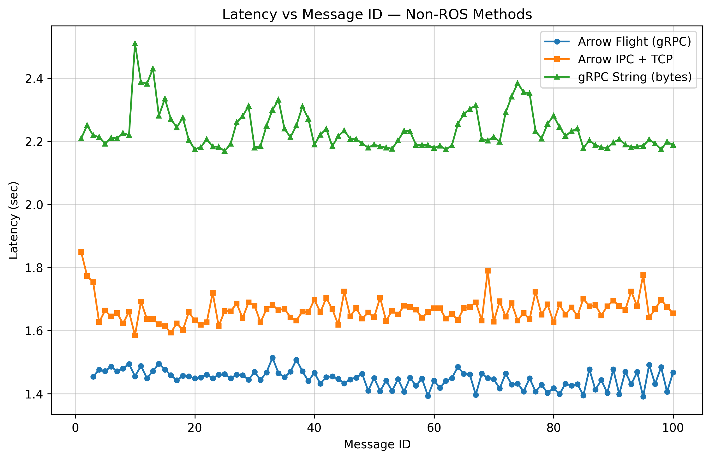
*Note: All three non-ROS methods show near-flat, stable latency on the Jetson Nano—no warm-up, no jitter spikes.*

### 2. Stability & Jitter
Non-ROS methods remain exceptionally stable on the Jetson Nano:

* **Arrow Flight (gRPC):** Tightest of all at **1.45s** (std ≈ 0.027s). gRPC's flow control keeps delivery deterministic even on ARM.
* **Arrow IPC + TCP:** Very tight at **1.66s** (std ≈ 0.041s). Raw TCP handles the large payload with minimal fragmentation overhead.
* **gRPC String (bytes):** Stable at **2.23s** (std ≈ 0.063s). Single-message protobuf framing is less efficient but still far more predictable than ROS2 DDS on constrained hardware.

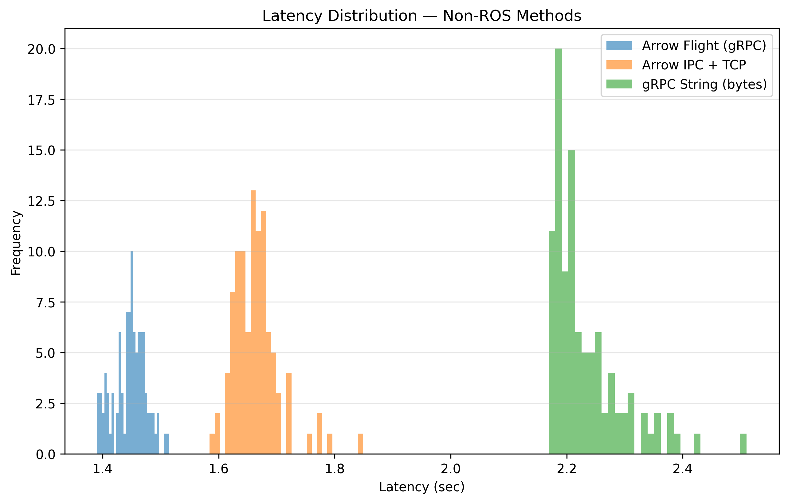

---

### Visualization Summary

* **Box Plot:** Three distinct, non-overlapping IQRs ordered by method—identical ranking to X86+X86. All three non-ROS IQRs sit well below the ROS2 UInt8MultiArray baseline of 3.59s.
* **Histogram:** Three separate narrow peaks with no overlap. Arrow Flight at ~1.45s and Arrow IPC at ~1.66s form tight towers; gRPC String is slightly wider around ~2.23s.
* **CDF Plot:** All three non-ROS methods complete 100% of messages well before ROS2 UInt8MultiArray completes even its first. Step-function shapes confirm near-deterministic delivery on Jetson Nano hardware.

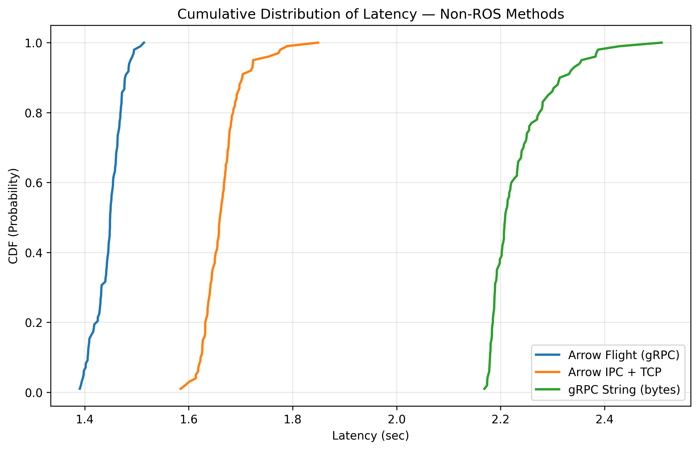

---

## Overall Method Comparison (Ethernet, X86 + X86)

| Method | Type | Avg Latency | vs. Slowest |
| :--- | :--- | :--- | :--- |
| **Arrow Flight (gRPC)** | Non-ROS | **1.3901s** | **53.3% Faster** |
| **Arrow IPC + TCP** | Non-ROS | **1.6057s** | **46.1% Faster** |
| **ROS2 UInt8MultiArray** | ROS2 | 2.1086s | 29.2% Faster |
| **gRPC String (bytes)** | Non-ROS | 2.1671s | 27.3% Faster |
| **ROS2 String (Base64)** | ROS2 | 2.9777s | — |

## Overall Method Comparison (Ethernet, X86 + Jetson Nano)

| Method | Type | Avg Latency | vs. Slowest |
| :--- | :--- | :--- | :--- |
| **Arrow Flight (gRPC)** | Non-ROS | **1.4472s** | **71.5% Faster** |
| **Arrow IPC + TCP** | Non-ROS | **1.6648s** | **67.2% Faster** |
| **gRPC String (bytes)** | Non-ROS | 2.2333s | **56.1% Faster** |
| **ROS2 UInt8MultiArray** | ROS2 | 3.5886s | 29.4% Faster |
| **ROS2 String (Base64)** | ROS2 | 5.0823s | — |

---

## Final Conclusion

The non-ROS comparison shows that **bypassing DDS is necessary but not sufficient** to achieve low latency—the choice of wire format and streaming protocol matters just as much.

* **Arrow Flight** is the fastest method tested overall in both hardware configurations. It combines Apache Arrow's zero-copy columnar format with gRPC's efficient bidirectional streaming. Its advantage over ROS2 UInt8MultiArray grows from ~34% (X86+X86) to ~60% (X86+Jetson Nano), demonstrating that Arrow Flight is especially well-suited to constrained receivers.
* **Arrow IPC + TCP** delivers nearly the same performance with a simpler stack (~24% faster on X86, ~54% faster on Jetson Nano). It is a strong alternative when avoiding the gRPC dependency is preferred.
* **gRPC String (bytes)** is a cautionary result on X86 (no advantage over ROS2 UInt8MultiArray), but becomes meaningful on Jetson Nano (~38% faster). The DDS middleware cost—not just payload size—is the differentiating factor on constrained hardware.
* **ROS2 UInt8MultiArray** remains the best choice within the ROS 2 ecosystem. On X86+X86 it matches gRPC String in raw latency while retaining all ecosystem benefits (topic introspection, launch files, bag recording, etc.). On Jetson Nano its relative position deteriorates significantly—non-ROS methods pull further ahead.

**Recommendation:** If ROS 2 integration is not required and minimum latency is the priority, Arrow Flight over Ethernet is the optimal transport for 150 MB float32 tensor payloads in both X86+X86 and X86+Jetson Nano configurations. The performance gap over ROS2 roughly doubles on constrained hardware, making the non-ROS investment especially worthwhile for edge deployments.
