# ROS 2 Latency Benchmark: UInt8MultiArray vs. String Base64 (numpy array)

This project benchmarks the performance of two data transmission methods in Ros2 Jazzy version when handling large payloads (**150 MB**). The data represents a `float32` NumPy array. 

In all of the following experiments one X86 machine is connected to the network via **Wifi** and
the other X86 machine and the Jetson Nano are connected to the network via a **Ethernet** cable.

**First Experiment Setup:**
* **Payload:** 150 MB (randomly generated `float32` array).
* **Environment:** Publisher and Subscriber running on the same X86 machine.

**Second Experiment Setup:**
* **Payload:** 150 MB (randomly generated `float32` array).
* **Environment:** Publisher runs on X86 machine and Subscriber runs on a Jetson Nano.
* **Network Type:** Local Network 

**Third Experiment Setup:**
* **Payload:** 150 MB (randomly generated `float32` array).
* **Environment:** Publisher runs on X86 machine and Subscriber runs on another X86 machine.
* **Network Type:** Local Network

**UDP test [TODO]:**
Calculate highest theoretical throughput achieved with raw UDP using [Iperf3](https://iperf.fr/). 
- On the machine that would run the ROS publisher, run `python3 udp_test.py --ip <remote host address> --remote_user <remote host name> --trials 100 --duration 30`. The script creates a timestamped folder, gathers and logs local and remote (through ssh) machine hardware specifications, runs iperf3 server on the remote host, and the iperf3 client locally (you might need to input your ssh credentials twice if you don't login with an ssh key).

**TCP test [TODO]:**
Calculate highest theoretical throughput achieved with raw TCP using [Iperf3](https://iperf.fr/). 
- On the machine that would run the ROS publisher, run `python3 tcp_test.py --ip <remote host address> --remote_user <remote host name> --trials 100 --duration 30`. The script creates a timestamped folder, gathers and logs local and remote (through ssh) machine hardware specifications, runs iperf3 server on the remote host, and the iperf3 client locally (you might need to input your ssh credentials twice if you don't login with an ssh key).
## How to Run These Experiments

Start the **subscriber first**, then the publisher. Both sides need ROS 2 Jazzy sourced and
the same `ROS_DOMAIN_ID`. Run from inside the method directory so `--folder` reproduces the
results tree. Collect ~100 messages (5 s apart → ~9 min), then `Ctrl-C` both sides.

```bash
source /opt/ros/jazzy/setup.bash
export ROS_DOMAIN_ID=0
```

**First Experiment** — publisher and subscriber on the same X86 machine, two terminals:

```bash
cd uint8multiarray                                  # then repeat in string/
python3 subscriber.py --folder wifi/same_machine
python3 publisher.py  --folder wifi/same_machine
```

**Second Experiment** — X86 publisher (WiFi) → Jetson Nano subscriber (Ethernet). Note the
folder is `diff_machine`, **singular**, for the single-array methods:

```bash
# on the Jetson Nano
cd uint8multiarray && python3 subscriber.py --folder wifi/diff_machine

# on the X86 machine
cd uint8multiarray && python3 publisher.py  --folder wifi/diff_machine
```

**Third Experiment** — X86 publisher (WiFi) → X86 subscriber (Ethernet):

```bash
# on the subscriber X86
cd uint8multiarray && python3 subscriber.py --folder wifi/x86_machines

# on the publisher X86
cd uint8multiarray && python3 publisher.py  --folder wifi/x86_machines
```

Repeat each of the three for `string/` to get the comparison pair. Then generate the plots:

```bash
cd analysis && python3 plot_analysis.py
```

Before trusting any result, confirm nothing was dropped — the two counts should match:

```bash
wc -l uint8multiarray/wifi/x86_machines/*.csv
```

> **Note:** `string/` and `uint8multiarray/` contain a `custom_fast_dds.xml` tuning profile
> for large UDP payloads. It is not loaded automatically; to use it, export
> `FASTRTPS_DEFAULT_PROFILES_FILE=$PWD/custom_fast_dds.xml` on **both** sides before
> launching.

---

## First Experiment
We compared **UInt8MultiArray** (Raw Binary) against **String Base64** (Text Encoding). The goal was to measure **Latency**—the total time from message publication to successful receipt and reconstruction.

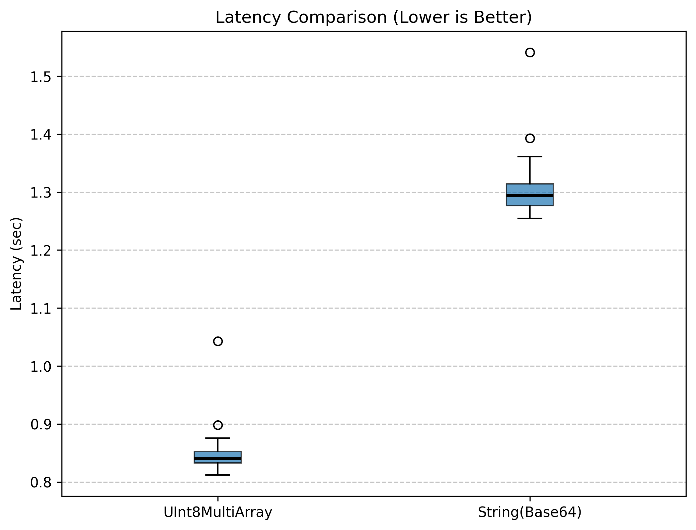

### The Results at a Glance
| Metric | UInt8MultiArray (Binary) | String (Base64) |
| :--- | :--- | :--- |
| **Payload Size** | 150 MB | 150 MB |
| **Transmission Size** | ~150 MB | ~200 MB (33% overhead) |
| **Average Latency** | **0.8447 seconds** | **1.3001 seconds** |
| **Performance Gain** | **~35% Faster** | - |

---

## Key Findings

### 1. Speed & Efficiency: The "Serialization Tax"
The **UInt8MultiArray** is significantly faster because it uses raw memory casting. By calling `.tobytes()` and `np.frombuffer()`, the system avoids complex data translation. 

The **String (Base64)** method incurs a heavy "Serialization Tax." The CPU must mathematically transform every byte into an ASCII character, increasing the data volume to **200 MB** and adding a constant overhead of roughly **0.45 seconds**.

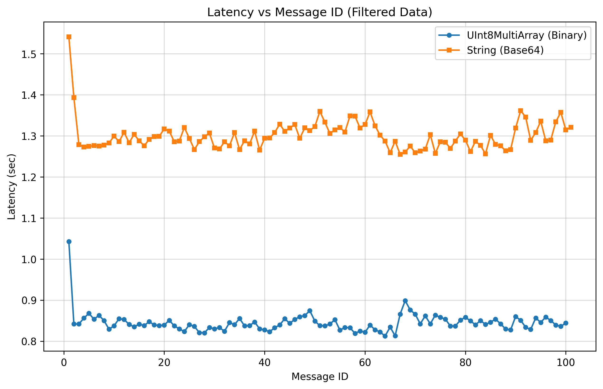
*Note: Both methods show a "warm-up" spike for the first few messages before stabilizing.*

### 2. Stability & Jitter
As shown in the distribution plots, the binary method is not only faster but more **predictable**:
- **Binary (Blue):** Highly stable with very low variance (tightly packed histogram).
- **Base64 (Orange):** Exhibits significant **jitter** (latency spikes). This is due to the inconsistent CPU time required to decode large Base64 strings.

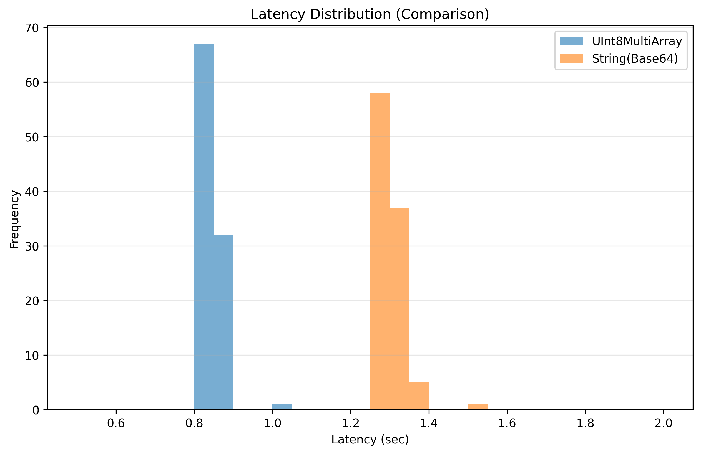

---

### Visualization Summary

* **Box Plot:** Demonstrates that the "worst-case" outliers for the binary method are still significantly faster than the "best-case" scenarios for Base64.
* **Histogram:** Displays two distinct, non-overlapping populations. The binary group is localized at the 0.8s mark, while the Base64 group is spread across the 1.3s mark.
* **CDF Plot:** Confirms that **100%** of binary messages are fully processed before the first Base64 message even arrives.

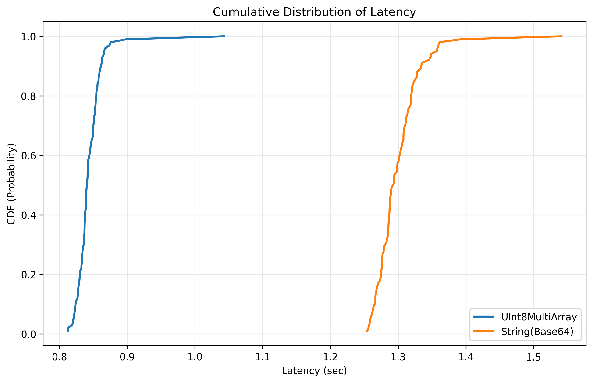

## Second Experiment
We compared **UInt8MultiArray** (Raw Binary) against **String Base64** (Text Encoding). The goal was to measure **Latency**—the total time from message publication to successful receipt and reconstruction.

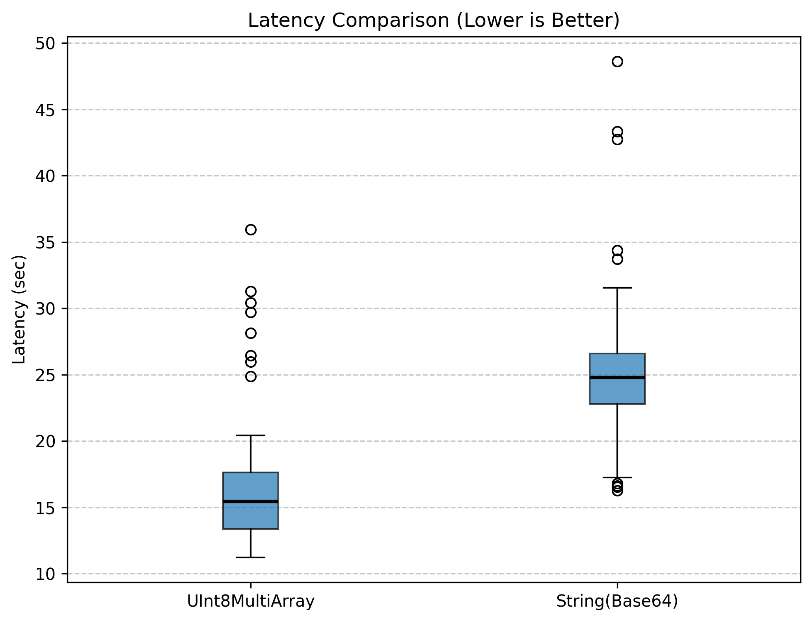

### The Results at a Glance
| Metric | UInt8MultiArray (Binary) | String (Base64)        |
| :--- |:-------------------------|:-----------------------|
| **Payload Size** | 150 MB                   | 150 MB                 |
| **Transmission Size** | ~150 MB                  | ~200 MB (33% overhead) |
| **Average Latency** | **16.3764 seconds**      | **24.8816 seconds**    |
| **Performance Gain** | **~34.2% Faster**        | -                      |

---

## Key Findings

### 1. Speed & Efficiency: The "Serialization Tax"
In a multi-machine environment, UInt8MultiArray is the superior transport method because it minimizes the raw data footprint. By utilizing .tobytes() and np.frombuffer(), the system performs a direct memory cast to raw binary, ensuring that only the original 150 MB is pushed to the network interface.

In contrast, the String (Base64) method imposes a massive "Bandwidth Tax." Beyond the CPU overhead of mathematical transformation, the encoding expands the data volume by 33%, forcing the network to handle 200 MB per message. This expansion directly causes the ~8.5-second latency gap observed in the results.

Note: Both methods exhibit an initial "warm-up" spike (visible in the Msg ID plot) as the DDS middleware establishes discovery and allocates network buffers before reaching a stabilized, albeit volatile, state.


*Note: Both methods show a "warm-up" spike for the first few messages before stabilizing.*

### 2. Stability & Jitter
The Multi-Machine experiment confirms that the binary method is not only faster but far more predictable under heavy network load.

* UInt8MultiArray (Blue): Demonstrates high consistency. In the histogram, the blue bars form a tight, tall "tower" between 12 and 18 seconds. This indicates that the network can reliably handle the 150 MB binary payload with minimal variance.

* Base64 (Orange): Exhibits extreme jitter and unpredictability. The orange distribution is much wider and shifted significantly to the right (peaking around 25 seconds). Because the 200 MB payload pushes the network to its physical limit, even minor congestion causes massive delays, as seen in the "long tail" of the histogram and the boxplot outliers reaching 48+ seconds.

* The Overlap Zone: The small brownish region where the two shapes meet (roughly between 16 and 20 seconds) represents rare instances where the methods perform similarly. This occurs when a "lucky" String message catches a window of perfect network health, allowing it to match the speed of a "slow" Binary message delayed by a minor collision. However, this is the exception, not the rule; the vast separation of the peaks proves that Binary is systematically superior.


### Visualization Summary

* **Box Plot:** Highlights the massive performance gap; the "worst-case" outliers for the Binary method (the highest spikes) are still significantly faster than the "average" (median) performance of the Base64 method.

* **Histogram:** Displays two distinct populations with a minimal overlap zone. The Binary group is localized and tall between 12s and 18s, while the Base64 group is spread much wider across the 24s to 28s range, demonstrating higher variance.

* **CDF Plot:** Confirms a "Deterministic vs. Probabilistic" divide. The steep Binary curve shows that 90% of binary messages are fully processed before even the first 20% of Base64 messages arrive, proving far superior reliability for time-critical tasks.


## Third Experiment
We compared **UInt8MultiArray** (Raw Binary) against **String Base64** (Text Encoding) across two high-performance **x86 machines**. The goal was to measure **Latency**—the total time from message publication to successful receipt and reconstruction.


### The Results at a Glance
| Metric | UInt8MultiArray (Binary) | String (Base64) |
| :--- | :--- | :--- |
| **Payload Size** | 150 MB | 150 MB |
| **Transmission Size** | ~150 MB | ~200 MB (33% overhead) |
| **Average Latency** | **8.6934 seconds** | **11.0463 seconds** |
| **Performance Gain** | **~21.3% Faster** | - |

---

## Key Findings

### 1. Speed & Efficiency: Processing Power vs. Bandwidth
In this x86-to-x86 environment, the powerful processors significantly reduce the absolute latency compared to the Jetson Nano (Experiment 2). However, the **Binary** method still holds a clear lead. By utilizing direct memory casting, the system avoids the overhead of text conversion, ensuring the network only has to move the original 150 MB.

Despite the high-end CPUs, the **String (Base64)** method remains slower due to the inescapable "Bandwidth Tax." Pushing 200 MB over the local network remains the primary bottleneck, adding over **2 seconds** of latency compared to the raw binary approach.


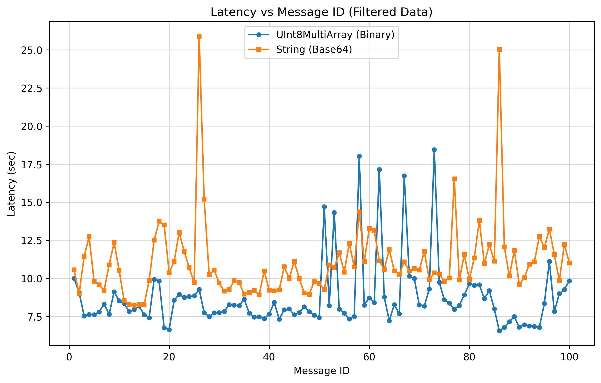
*Note: The time-series plot shows that while x86 handles data faster, the String method still suffers from higher volatility and periodic spikes.*

### 2. Stability & Jitter
Even with superior hardware, the binary method proves to be the most reliable for high-bandwidth communication:

* **UInt8MultiArray (Blue):** Highly consistent. The histogram shows a tight cluster peaking between **7s and 9s**. This narrow distribution indicates a highly stable and predictable communication channel.
* **Base64 (Orange):** Shows increased variance and a clear shift to the right. The distribution is wider, peaking between **10s and 12s**, and remains susceptible to network-induced jitter.
* **The Overlap Zone:** While there is a moderate overlap between 8s and 10s where x86 processing power helps "mask" the Base64 overhead, the Binary method's peak is consistently lower, proving it is the only way to achieve maximum throughput.

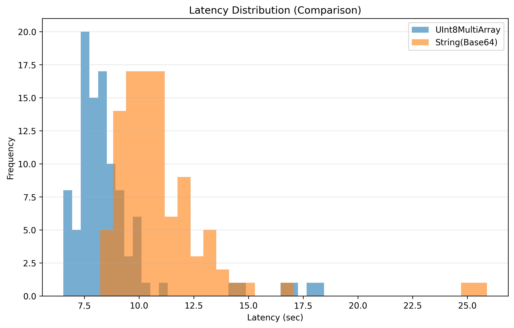

---

### Visualization Summary

* **Box Plot:** Highlights that the median latency for the **Binary** method is lower than the 25th percentile of the **Base64** method, proving it is faster in almost every individual trial.
* **Histogram:** Displays two distinct distributions. The Binary group forms a tall, localized "tower" at the start of the timeline, whereas the Base64 group is spread further across the x-axis.
* **CDF Plot:** Confirms that roughly **80%** of Binary messages are completed before the first **20%** of Base64 messages, even on high-performance hardware.


## BabyROS (Zenoh) Comparison — Single Array

Adding [BabyROS](babyros/README.md) to this experiment. It keeps a ROS-style
publisher/subscriber API but replaces DDS with Zenoh, sending numpy arrays as raw bytes
with a JSON manifest — no IDL, no Base64.

| Method | X86 + X86 | X86 + Jetson Nano |
| :--- | :--- | :--- |
| **BabyROS (Zenoh)** | **6.0422s** | **5.3616s** |
| UInt8MultiArray (Binary) | 8.6934s | 16.3764s |
| String (Base64) | 11.0463s | 24.8816s |

Jitter (standard deviation):

| Method | X86 + X86 | X86 + Jetson Nano |
| :--- | :--- | :--- |
| **BabyROS (Zenoh)** | 2.3820s | **0.4881s** |
| UInt8MultiArray (Binary) | 2.2182s | 4.3378s |
| String (Base64) | 2.5777s | 5.2526s |

BabyROS is **30% faster** than the best ROS 2 method between PCs (6.0422s vs 8.6934s), and
**67% faster** to the Jetson Nano (5.3616s vs 16.3764s).

The Jetson number is the surprising one. Both ROS 2 methods get much worse on the small
board — UInt8MultiArray goes from 8.69s to 16.38s, nearly double. BabyROS goes the other
way and records its *best* WiFi time there, 5.36s. WiFi loses far more packets than a cable,
and ROS 2 makes the receiver do the work of sorting that out; the small board cannot keep
up. BabyROS asks much less of it.

Steadiness tells the same story. Between PCs all three methods wobble by a similar amount
(±2.2–2.6s) because the WiFi signal itself is unsteady. But to the Jetson, BabyROS varies by
only **±0.4881s** where UInt8MultiArray swings **±4.3378s** — nine times steadier, on top of
being three times faster.

### Visualization Summary

**X86 + X86**

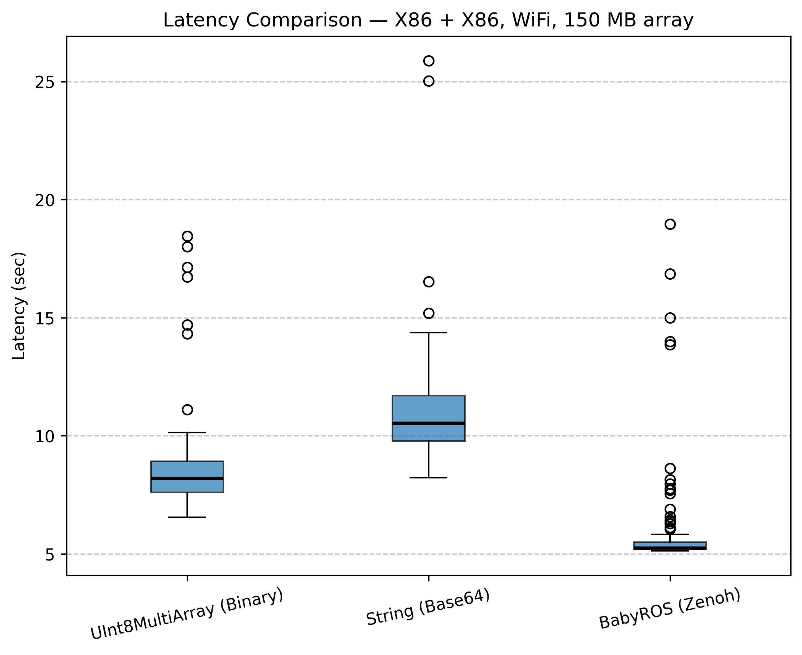
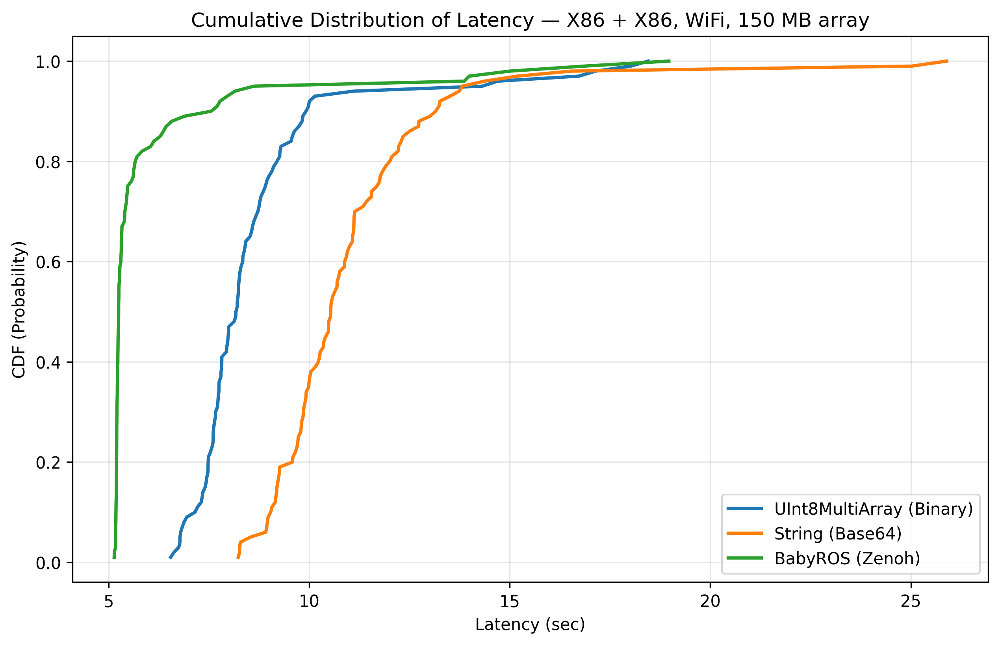
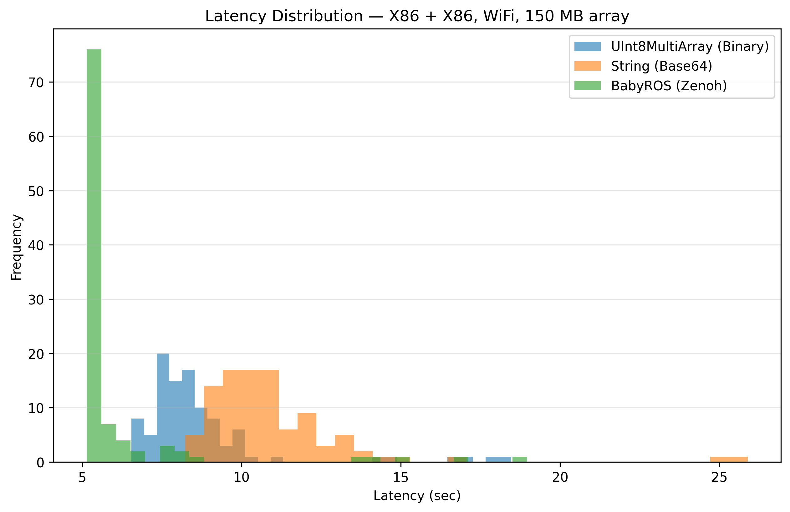
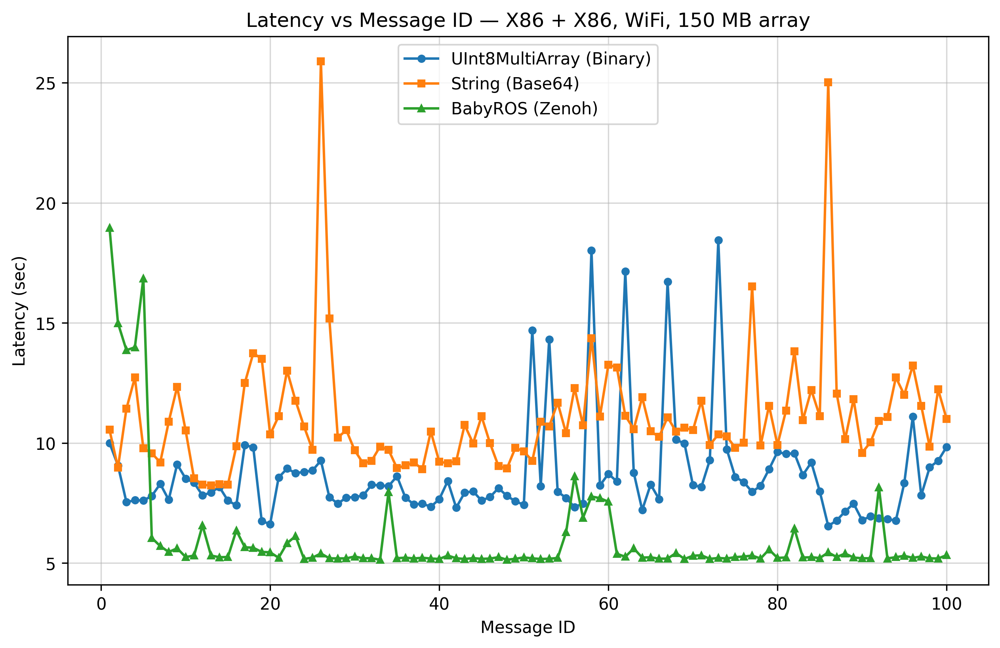

**X86 + Jetson Nano**

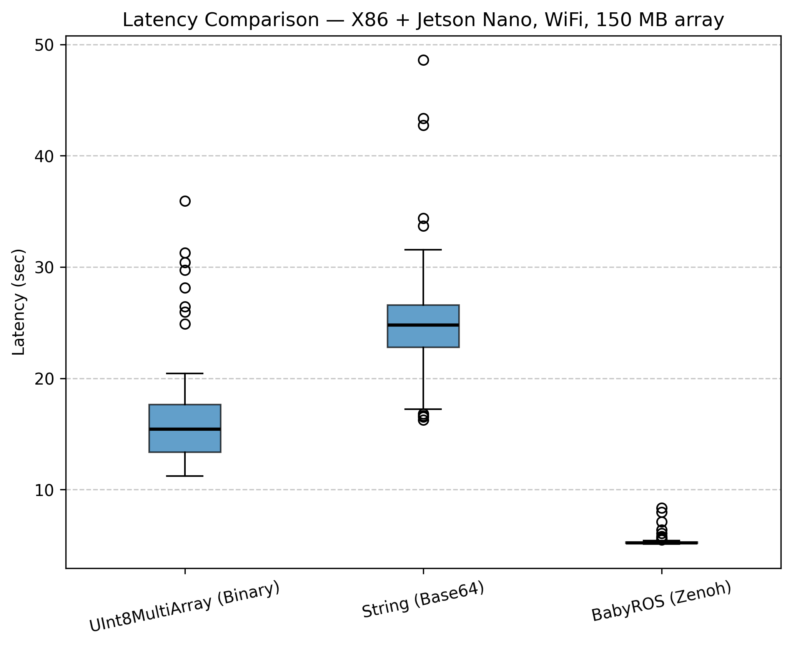
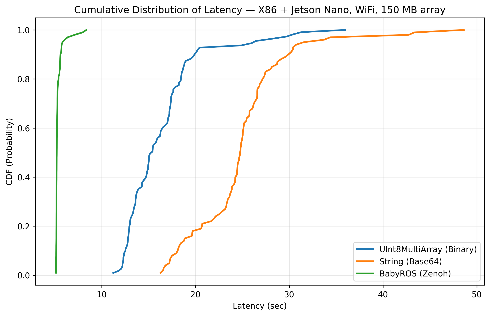
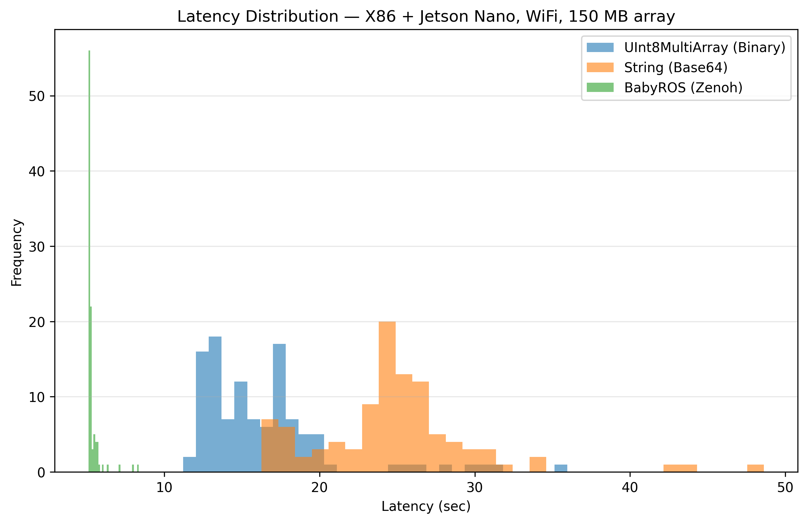
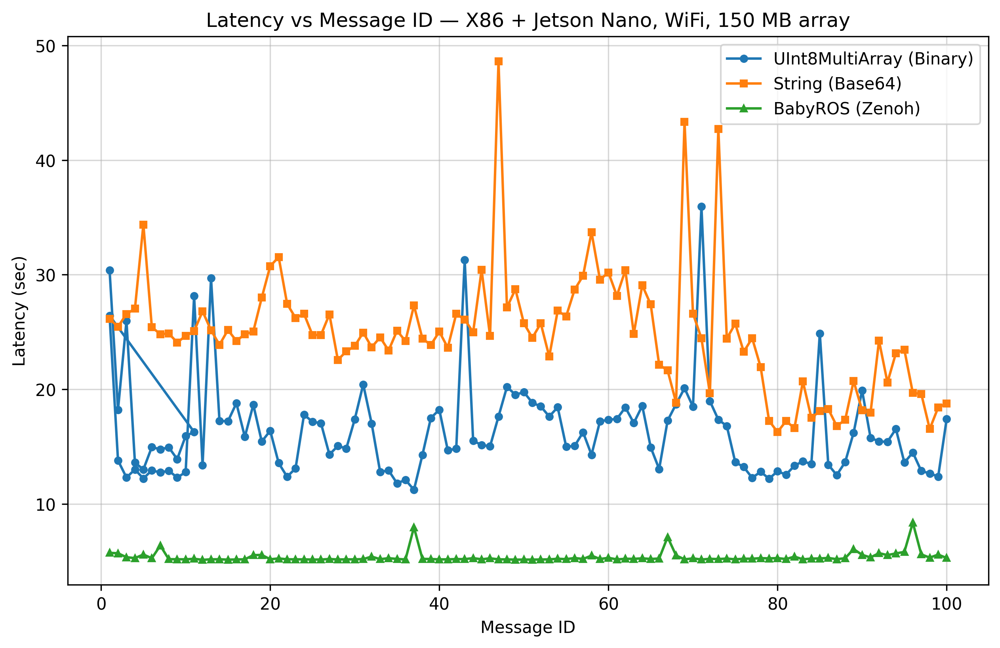

---

## Final Conclusion

Across all three experiments, UInt8MultiArray (Binary) is the mandatory choice for high-bandwidth ROS 2 applications.

* **One X86 machine:** Binary utilizes direct memory casting (zero-copy potential). In contrast, Base64 forces the CPU to perform millions of unnecessary algebraic operations to "text-encode" data that is already in memory, adding a ~0.45s "computational tax" even when no network is involved.
* **X86 + ARM:** In this configuration, the Jetson Nano is the "bottleneck." Base64 forces the Jetson’s limited ARM cores to work significantly harder to decode the 200 MB string back into a NumPy array. Simultaneously, the 33% larger payload saturates the Jetson's network interface and memory bus. Using Binary eliminates the decoding CPU spike and reduces the data footprint, preventing the Jetson from "falling behind" and dropping frames.
* **X86 + X86:** Even with high-performance CPUs, the Physical Bandwidth Ceiling remains the bottleneck. By keeping the payload at 150 MB instead of 200 MB, the Binary method minimizes the number of UDP packets, reducing the probability of network collisions and ensuring deterministic arrival times.

Recommendation: For AI tensors, the usage UInt8MultiArray optimizes the communication. The convenience of String types is outweighed by massive latency penalties, increased thermal load, and dangerous network instability.

# ROS 2 Latency Benchmark: UInt8MultiArray vs. String Base64 (list of numpy arrays)

This project benchmarks the performance of two data transmission methods in Ros2 Jazzy version when handling large payloads (**~150 MB**). The data represents a list of `float32` NumPy arrays.
The shapes of the numpy arrays are:

```python
self.shapes = [
    (1, 120, 160, 5, 64),
    (1, 120, 160, 5, 64, 3),
    (1, 120, 160, 6),
    (1, 120, 160)
]
```

**First Experiment Setup:**
* **Payload:** ~150 MB (list of generated `float32` numpy arrays).
* **Environment:** Publisher and Subscriber running on the same X86 machine.

**Second Experiment Setup:**
* **Payload:** ~150 MB (list of generated `float32`  numpy arrays).
* **Environment:** Publisher runs on X86 machine and Subscriber runs on a Jetson Nano.
* **Network Type:** Local Network

**Third Experiment Setup:**
* **Payload:** ~150 MB (list of generated `float32` numpy arrays).
* **Environment:** Publisher runs on X86 machine and Subscriber runs on another X86 machine.
* **Network Type:** Local Network

## How to Run These Experiments

Same pattern as the single-array experiments above — subscriber first, matching
`ROS_DOMAIN_ID`, run from inside the method directory. The methods here are
`uint8multiarray_list_numpy_array/` and `string_list_numpy_array/`.

⚠️ The folder for the Jetson Nano run is `diff_machines` (**plural**) in these list
experiments, unlike the singular `diff_machine` used by the single-array ones.

```bash
source /opt/ros/jazzy/setup.bash
export ROS_DOMAIN_ID=0
cd uint8multiarray_list_numpy_array     # then repeat in string_list_numpy_array/

# First  — both nodes on one X86 machine
python3 subscriber.py --folder wifi/same_machine
python3 publisher.py  --folder wifi/same_machine

# Second — X86 publisher → Jetson Nano subscriber
python3 subscriber.py --folder wifi/diff_machines     # on the Jetson
python3 publisher.py  --folder wifi/diff_machines     # on the X86

# Third  — X86 publisher → X86 subscriber
python3 subscriber.py --folder wifi/x86_machines
python3 publisher.py  --folder wifi/x86_machines
```

Plots for this set are written to `analysis/wifi/plots_2nd/` by the same script:

```bash
cd analysis && python3 plot_analysis.py
```

## First Experiment
We compared **UInt8MultiArray** (Raw Binary) against **String Base64** (Text Encoding). The goal was to measure **Latency**—the total time from message publication to successful receipt and reconstruction.

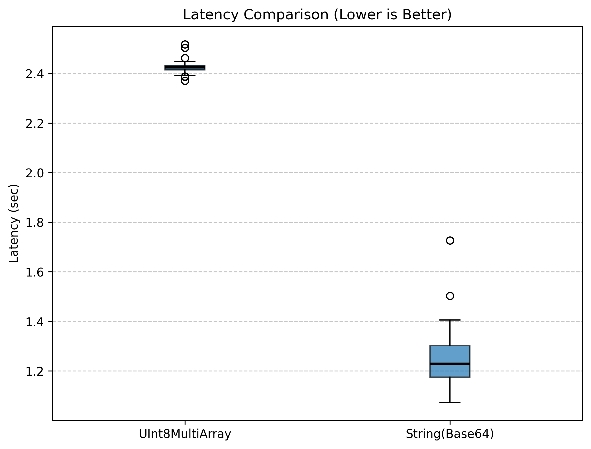

### The Results at a Glance
| Metric | UInt8MultiArray (Binary) | String (Base64) |
| :--- | :--- | :--- |
| **Payload Size** | ~150 MB | ~150 MB |
| **Transmission Size** | ~150 MB | ~200 MB (33% overhead) |
| **Average Latency** | **2.4251 seconds** | **1.2436 seconds** |
| **Performance Gain** | - | **~49% Faster** |

---

## Key Findings

### 1. Speed & Efficiency: The "Packing Overhead Tax"
In this same-machine experiment, the result is **reversed** compared to the single-array benchmark. **String (Base64)** is significantly faster because the cost of concatenating multiple separate array chunks into a single flat UInt8MultiArray payload dominates over the CPU cost of Base64 encoding on a high-performance local machine with no network bottleneck.

The **UInt8MultiArray** method must pack every array in the list into one contiguous byte sequence before transmission, adding a constant multi-step serialization overhead of roughly **1.2 seconds** even without any network involvement.

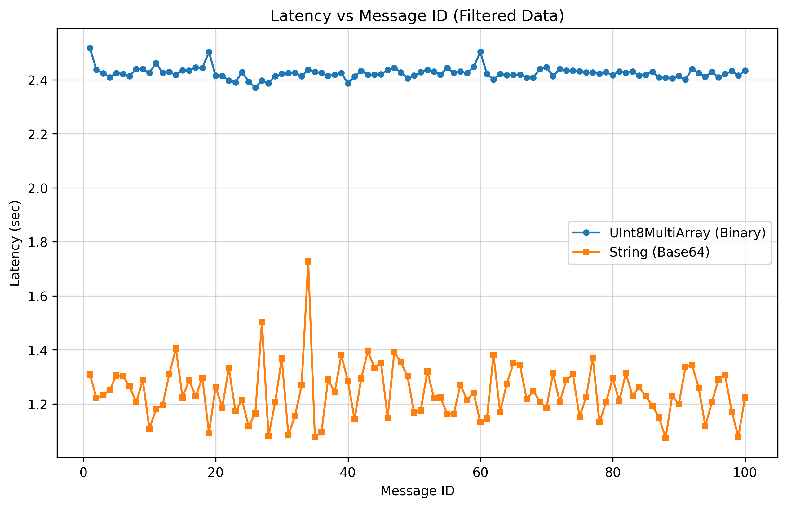
*Note: The binary method runs as a perfectly flat line at ~2.4s, while String fluctuates between 1.1s and 1.7s with no warm-up effect.*

### 2. Stability & Jitter
While String is faster in this configuration, the binary method demonstrates exceptional predictability:

* **UInt8MultiArray (Blue):** Virtually zero variance. The histogram shows an ultra-narrow, tall tower tightly packed at the ~2.4s mark, indicating a completely deterministic serialization process.
* **String (Base64) (Orange):** Faster overall, but exhibits more spread. The distribution ranges from 1.1s to 1.4s with occasional outliers reaching 1.7s, reflecting variable CPU time for Base64 encoding of the individual array chunks.

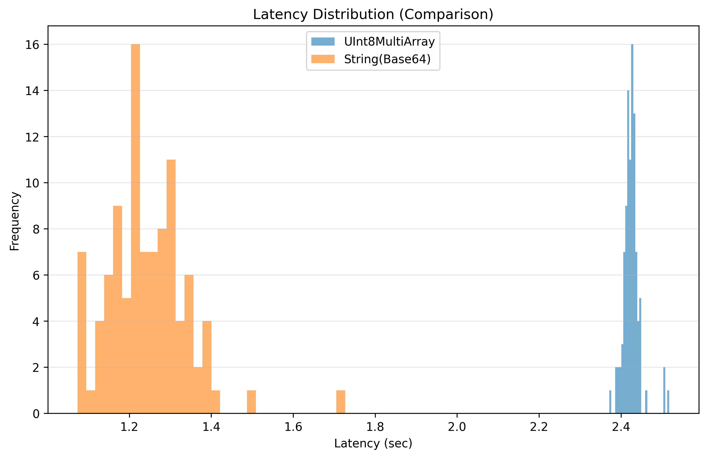

---

### Visualization Summary

* **Box Plot:** The Binary box is microscopically narrow (IQR spans only ~0.05s around 2.42s), while the String box sits entirely below it spanning 1.1s to 1.4s. There is no overlap between the two methods.
* **Histogram:** Two completely non-overlapping populations. The String group (orange) spreads between 1.1s and 1.7s, while the Binary group (blue) forms an extremely tight tower at 2.4s.
* **CDF Plot:** Confirms full separation—100% of String messages complete before even the first Binary message arrives. String’s CDF completes by ~1.75s; Binary’s CDF does not begin until ~2.3s.

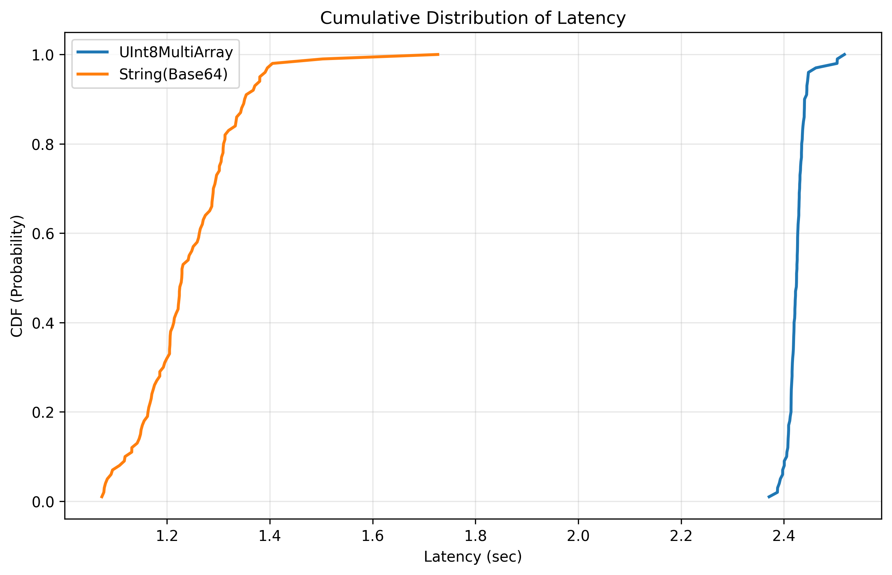

## Second Experiment
We compared **UInt8MultiArray** (Raw Binary) against **String Base64** (Text Encoding) across an X86 publisher and a **Jetson Nano** subscriber. The goal was to measure **Latency**—the total time from message publication to successful receipt and reconstruction over a local network.

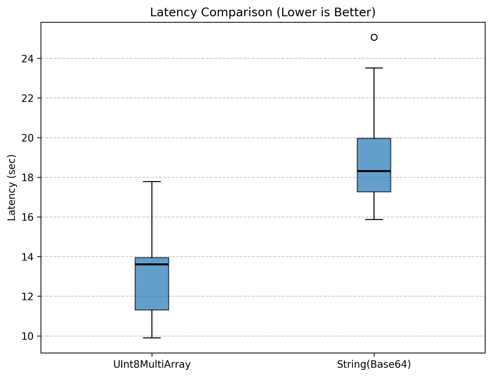

### The Results at a Glance
| Metric | UInt8MultiArray (Binary) | String (Base64) |
| :--- | :--- | :--- |
| **Payload Size** | ~150 MB | ~150 MB |
| **Transmission Size** | ~150 MB | ~200 MB (33% overhead) |
| **Average Latency** | **12.9736 seconds** | **18.7159 seconds** |
| **Performance Gain** | **~30.7% Faster** | - |

---

## Key Findings

### 1. Speed & Efficiency: Network Bandwidth as the Bottleneck
Once the payload crosses a network boundary to the bandwidth-constrained Jetson Nano, the binary advantage is fully restored. By transmitting only 150 MB instead of 200 MB, **UInt8MultiArray** directly relieves the Jetson’s limited network interface and memory bus, cutting transmission time significantly.

The **String (Base64)** method’s 33% size expansion becomes a decisive penalty here—forcing 50 MB of extra data through the network on every single message, while the Jetson’s limited ARM cores simultaneously struggle to decode the larger payload.

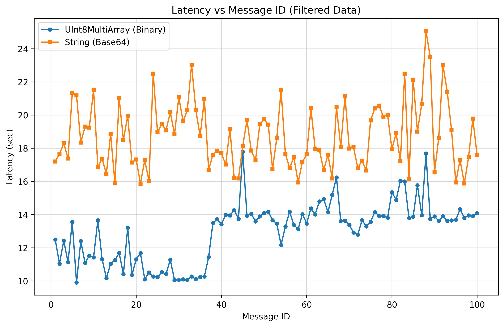
*Note: The binary time series shows a phase shift around message 40 (jumping from ~11s to ~14s), while String remains highly volatile throughout the entire run at 16–25s.*

### 2. Stability & Jitter
The cross-machine environment exposes a clear determinism gap between the two methods:

* **UInt8MultiArray (Blue):** Bimodal distribution with two clusters—one around 10–11s (early messages before the phase shift) and a dominant peak near 14s (the majority of messages). Despite the phase shift, total variance is far lower than String.
* **String (Base64) (Orange):** Wide, spread-out distribution from 16s to over 24s, peaking around 17–18s. The larger payload amplifies sensitivity to any network congestion, producing extreme jitter and a long outlier tail reaching ~25s.
* **Overlap Zone:** A narrow overlap exists around 15–16s where the tail of Binary messages meets the earliest String messages. This is the exception, not the rule.

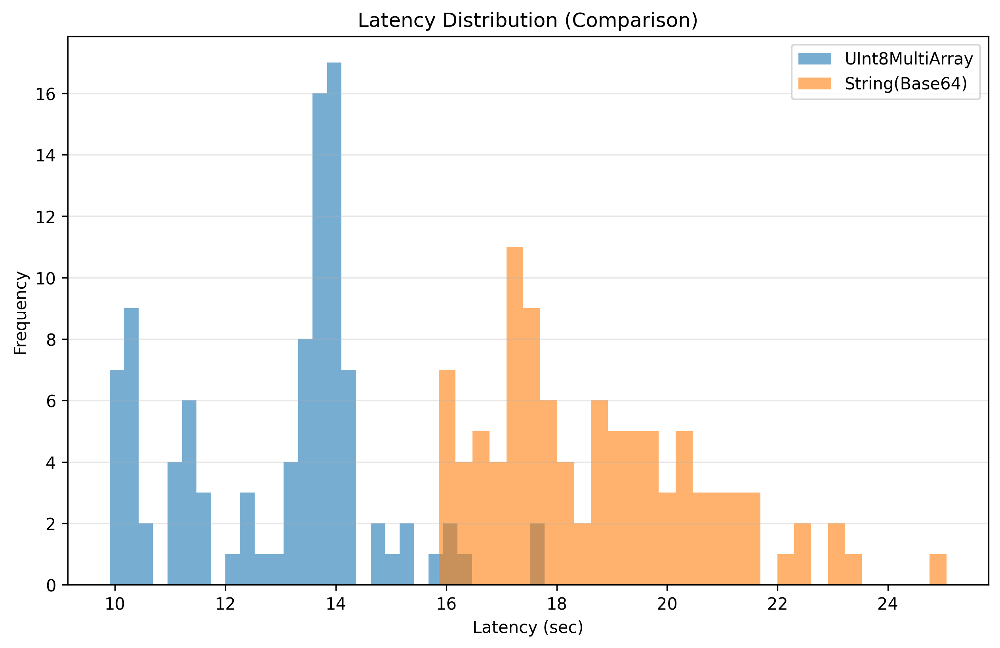

---

### Visualization Summary

* **Box Plot:** The Binary IQR (approximately 11–14s) sits entirely below the String IQR (approximately 17.5–20s). The Binary worst-case whisker (~18s) barely reaches the String median (~18.5s), confirming Binary’s systematic advantage.
* **Histogram:** Two distinct populations with minimal overlap. Binary has a bimodal shape concentrated below 15s; String is broadly spread from 16s to 25s with no dominant single peak.
* **CDF Plot:** The Binary curve completes 100% of messages by ~18s; the String curve does not reach its midpoint (50%) until ~18s, confirming that Binary finishes entirely before String even reaches the halfway mark.

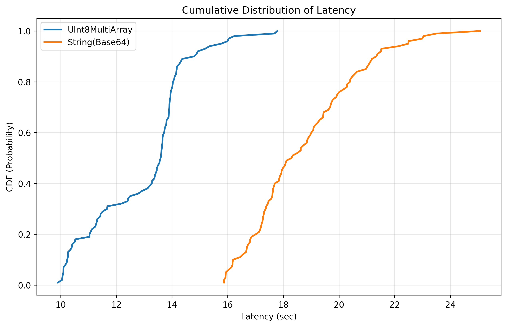

## Third Experiment
We compared **UInt8MultiArray** (Raw Binary) against **String Base64** (Text Encoding) across two high-performance **X86 machines**. The goal was to measure **Latency**—the total time from message publication to successful receipt and reconstruction over a local network.

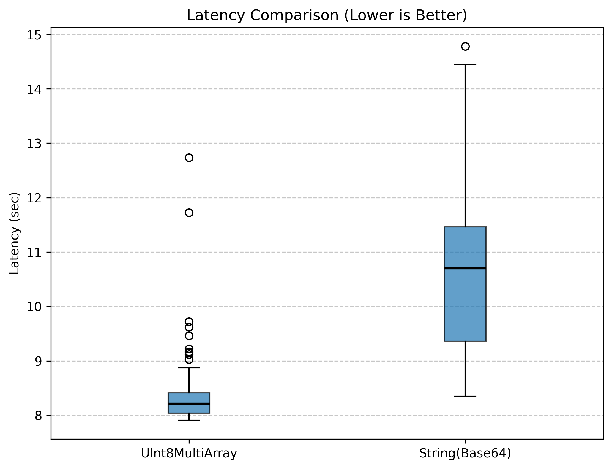

### The Results at a Glance
| Metric | UInt8MultiArray (Binary) | String (Base64) |
| :--- | :--- | :--- |
| **Payload Size** | ~150 MB | ~150 MB |
| **Transmission Size** | ~150 MB | ~200 MB (33% overhead) |
| **Average Latency** | **8.3911 seconds** | **10.5983 seconds** |
| **Performance Gain** | **~20.8% Faster** | - |

---

## Key Findings

### 1. Speed & Efficiency: Processing Power vs. Bandwidth
Between two powerful X86 machines, high CPU performance reduces the absolute gap compared to the Jetson Nano experiment, but **Binary** still maintains a clear advantage. The network bandwidth ceiling remains the primary bottleneck—keeping the payload at 150 MB rather than 200 MB directly reduces transmission time and packet count.

Despite fast processors on both ends, the **String (Base64)** method’s extra 50 MB of network traffic still adds over **2 seconds** of latency per message, and—critically—introduces far more unpredictability.

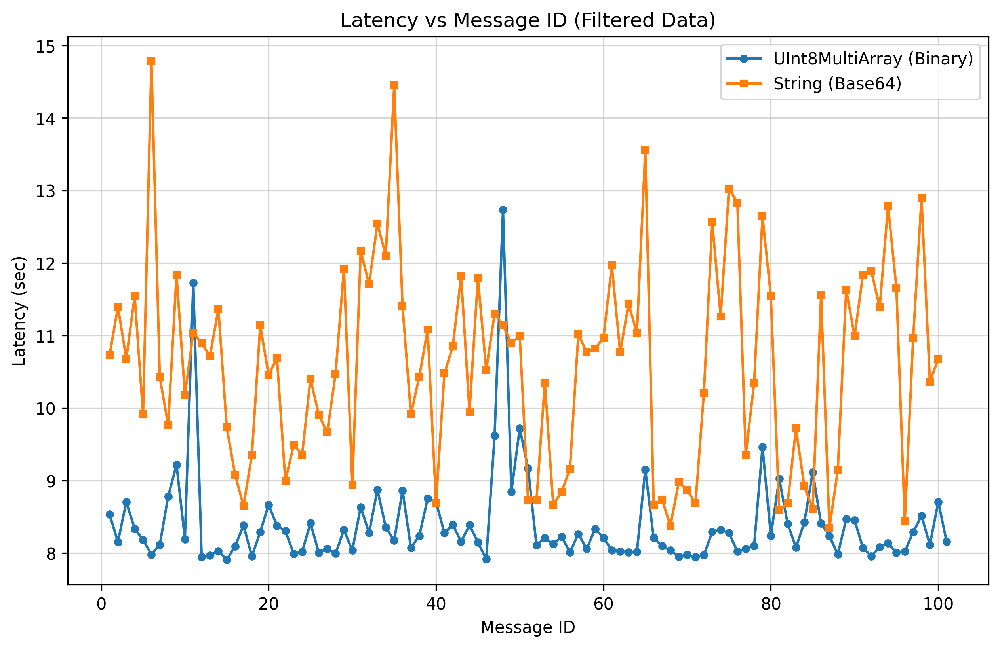
*Note: Binary holds a stable band around 8–9s while String fluctuates broadly from 9s to 15s with frequent large spikes.*

### 2. Stability & Jitter
Even with identical, high-performance hardware on both ends, the binary method is dramatically more predictable:

* **UInt8MultiArray (Blue):** Extremely tight distribution with a dominant peak at 8–8.5s (frequency ~30), dropping off sharply by 9s. A small cluster of outliers reaches up to ~12.7s, but the vast majority of messages land in a very narrow window.
* **String (Base64) (Orange):** Wide, flat distribution spread from 8s to 15s, with several local peaks around 9s, 10.5s, 11s, and 11.5s. The larger payload remains susceptible to unpredictable network timing even on capable symmetric hardware.
* **Overlap Zone:** A moderate overlap exists from ~8s to ~9.5s, where x86 processing speed briefly masks the Base64 overhead for the fastest String deliveries.

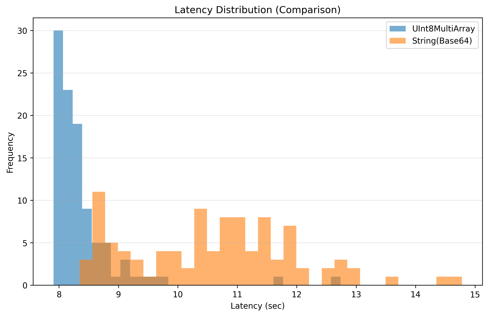

---

### Visualization Summary

* **Box Plot:** The Binary IQR is extremely narrow (~8–8.5s), while the String IQR spans ~9.5–11.5s. The Binary median (~8.2s) is lower than the String 25th percentile (~9.5s), meaning Binary beats String in nearly every individual trial.
* **Histogram:** The Binary group forms a very tall, steep spike at 8s (frequency ~30) that drops to near-zero by 9s. The String group is spread broadly from 8s to 15s with no dominant peak, indicating high unpredictability.
* **CDF Plot:** Binary reaches ~95% completion by 9s and 100% by ~10s. String does not reach 90% until ~13s, confirming Binary’s superior determinism even on high-performance symmetric hardware.

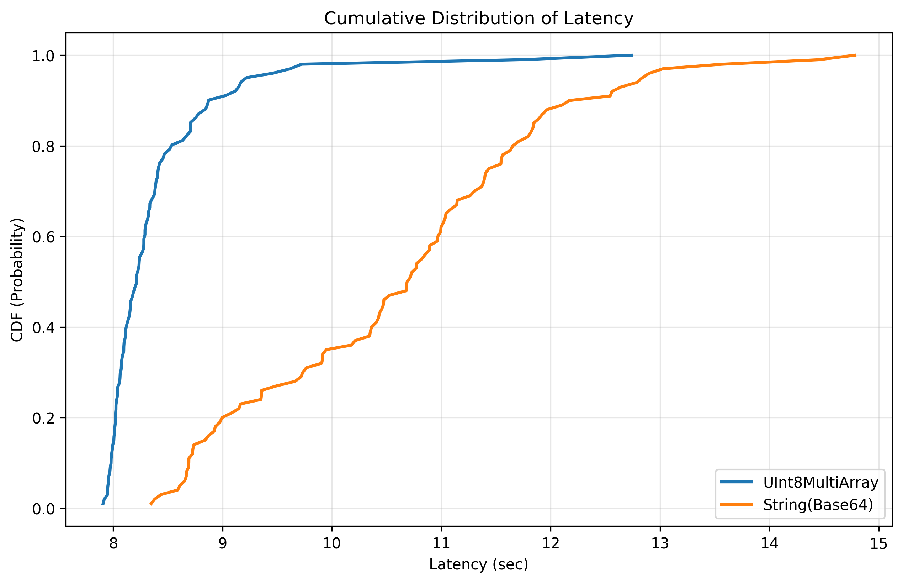

## BabyROS (Zenoh) Comparison — List of Arrays

| Method | X86 + X86 | Std Dev |
| :--- | :--- | :--- |
| **UInt8MultiArray (Binary)** | **8.3911s** | **0.6709s** |
| BabyROS (Zenoh) | 10.2884s | 1.2756s |
| String (Base64) | 10.5983s | 1.3949s |

**This is the only test in the whole study where BabyROS loses.** UInt8MultiArray finishes
in **8.3911s** against BabyROS's **10.2884s** — 23% faster — and is the steadiest of the
three as well (±0.6709s vs ±1.2756s).

It is the mirror image of the Ethernet result. On a fast cable the biggest cost is the ~1.2s
spent gluing the four blocks into one strip, which BabyROS skips — that is why it wins there
by 43–66%. But WiFi carries only about a seventh of what the cable does, so the transfer
itself takes 8–10s and 1.2s of gluing stops mattering. What matters instead is coping with
dropped packets, and ROS 2 handles that better here.

The measurement is stable rather than an artefact: latency was flat across the run
(+0.035s from the first ten messages to the last ten), so no queue backlog was inflating
it.

### Visualization Summary

**X86 + X86**

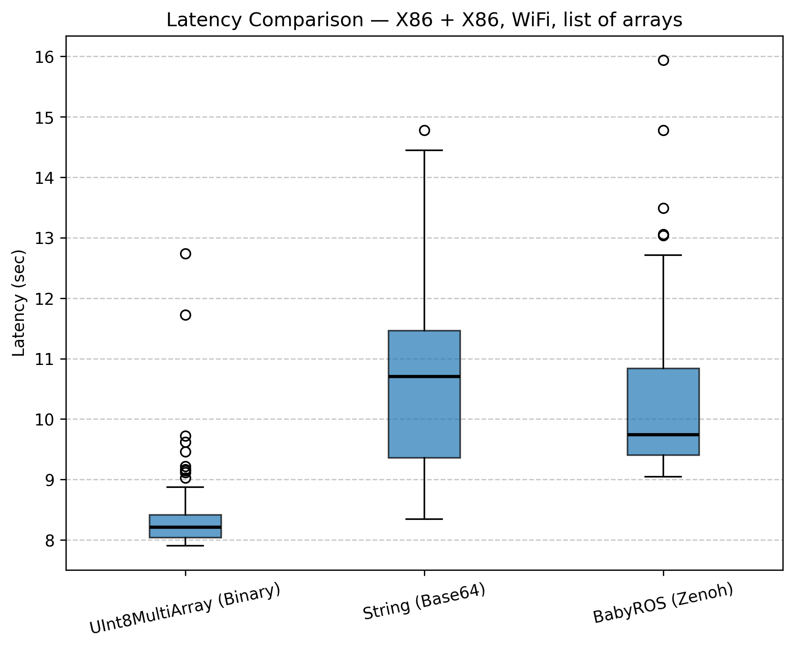
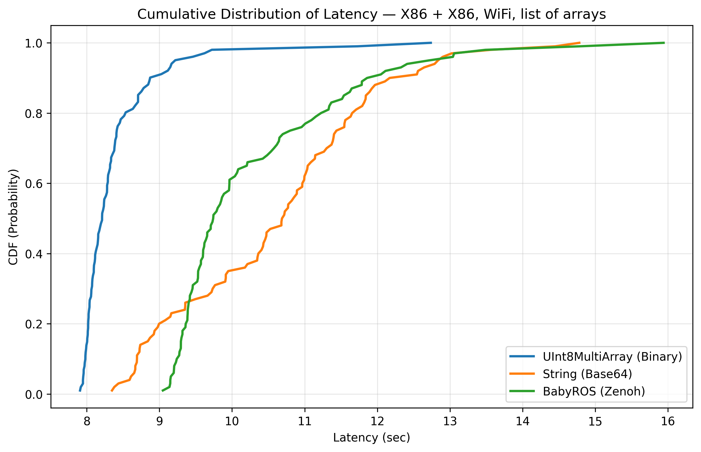
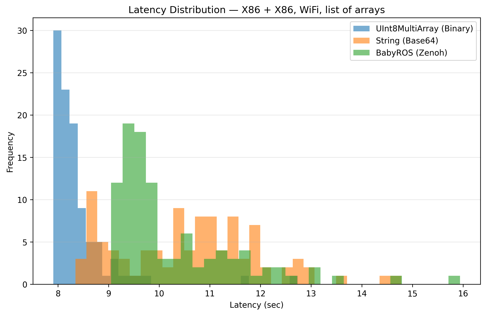
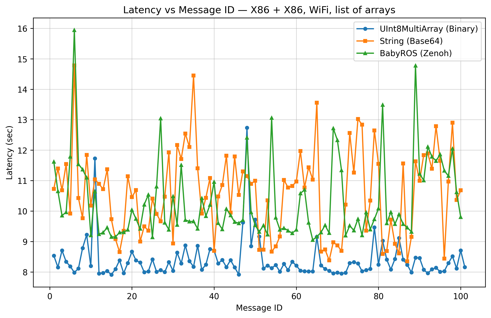

> The X86 + Jetson Nano configuration has not been collected for BabyROS on this payload
> shape (`babyros_list_numpy_array/wifi/diff_machines/` has a publisher log but no
> subscriber log), so it is absent from the table above.

---

## Final Conclusion

The list of generated float32 numpy arrays benchmark reveals a more nuanced picture than the single-array case.

* **One X86 machine:** The result is **reversed**—String (Base64) is ~49% faster. When packing a list of multi-dimensional arrays, the overhead of concatenating multiple array chunks into a single flat UInt8MultiArray payload dominates on a local machine where network bandwidth is not a constraint. However, the binary method still achieves near-perfect determinism with essentially zero variance, while String spreads across a 1.1s–1.7s range.
* **X86 + ARM (Jetson Nano):** Binary recovers its advantage with a **~30.7% faster** transmission. Crossing the network boundary makes the 33% payload reduction decisive. The Jetson Nano’s limited bandwidth and memory bus are directly relieved by the smaller 150 MB payload, while String’s 200 MB causes extreme jitter (16–25s range) and a long outlier tail.
* **X86 + X86:** Binary maintains a **~20.8% faster** transmission. With two capable machines, CPU speed partially reduces the Base64 encoding penalty, but the physical bandwidth ceiling keeps Binary ahead. More importantly, Binary provides dramatically better consistency—its distribution is essentially a single spike at 8s, while String scatters broadly from 8s to 15s.

**Recommendation:** For multi-array AI tensor transmission, the choice depends on context. If processing is strictly local with no network involved, String may deliver lower latency—but only when predictability is not critical. For any networked deployment, UInt8MultiArray is mandatory; the payload size reduction directly reduces transmission time and jitter at every network tier.